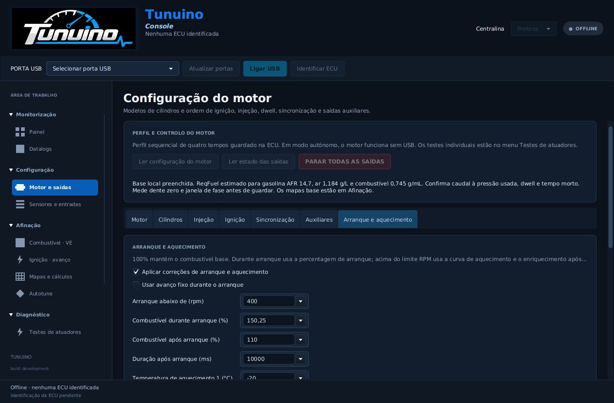

> Atualização: [TPS, ralenti PWM e controlo de turbo](ralenti-turbo-tps.md), com migração da flash e cópia `.tnaux` separada.

# Arranque, após arranque e aquecimento

A Console e o INI TunerStudio incluem configurações de arranque e aquecimento que o firmware aplica ao pulso real de injeção. O perfil, estas correções, sensores e mapas são guardados no mesmo registo protegido da flash. A configuração anterior continua com as correções desativadas.

Na Console: **Motor e saídas → Arranque e aquecimento**. Escolher valores, ativar as correções e usar **Guardar motor na ECU**. A gravação exige saídas desarmadas e confirma os valores por nova leitura. Ligar ou escolher uma opção no formulário não envia um comando físico.

| Configuração | Referência editável | Efeito |
|---|---:|---|
| Limite de arranque | 400 rpm | Abaixo deste valor utiliza o combustível de arranque |
| Combustível no arranque | 150% | Multiplica o combustível base durante o arranque |
| Combustível após arranque | 110% | Valor inicial ao atingir o limite RPM |
| Duração após arranque | 10000 ms | Redução linear do enriquecimento até 100% |
| Aquecimento ponto 1 | −20 °C / 160% | Extremo frio da curva |
| Aquecimento ponto 2 | 20 °C / 120% | Ponto intermédio |
| Aquecimento ponto 3 | 80 °C / 100% | Extremo quente da curva |
| Avanço fixo de arranque | 10°, opção desativada | Se ativado, substitui o mapa de ignição durante o arranque |

São referências para afinação, não calibrações verificadas num motor. As correções começam **desativadas**; desligar a opção conserva valores válidos para voltar a utilizá-los.

Durante o arranque, aplica-se a percentagem de arranque. Acima do limite RPM, o firmware interpola a curva de temperatura e multiplica-a pelo enriquecimento após arranque. Fora dos três pontos conserva o valor do extremo da curva. Não extrapola um enriquecimento crescente.

Exemplo de cálculo: pulso base de 3 ms, aquecimento de 120%, enriquecimento após arranque de 110% e tempo morto de 0,5 ms produzem `3 × 1,20 × 1,10 + 0,5 = 4,46 ms`. Após expirar o enriquecimento, passa a `3 × 1,20 + 0,5 = 4,10 ms`. O tempo morto é somado uma vez, no fim. Pulso superior ao máximo configurado ou à ocupação permitida do ciclo provoca corte; não é truncado silenciosamente.

O período após arranque só reinicia quando a rotação volta à zona de arranque ou o motor é ativado novamente. O contador de tempo suporta a passagem por zero sem reaplicar um enriquecimento expirado. Temperatura inválida, perda de sincronismo e as outras falhas mantêm os cortes existentes.

As durações aparecem em **ms**. Percentagens e temperaturas aceitam ponto ou vírgula decimal na Console, com validação sem arredondamento silencioso. O INI usa os mesmos campos, incluindo ativação e avanço fixo opcionais.

Os testes automáticos verificam os cálculos, interpolação, transições de RPM, redução temporal, reinício, passagem do contador por zero, desativação com valores conservados, backups, gravação interrompida e aplicação do pulso ao agendador de GPIO simulado. **Precisão elétrica e funcionamento num motor real continuam por validar.**

Continuam por implementar, entre outras funções, controlo VVT, detonação, flex fuel, launch control, Lua, correções de IAT/tensão, enriquecimento de aceleração e lambda em malha fechada.

Implementação: [f729548](https://github.com/Tunuino/Tunuino/commit/f729548be5b88a44a27a3835e27988b3dde973c8), com conservação dos valores no formulário em [e136968](https://github.com/Tunuino/Tunuino/commit/e136968f792e7b16a3bf2eedaa1c322535e381bf). Os cinco processos de componentes — núcleo, Windows, interface desktop, TunerStudio e F427 — passaram para o commit final. O Bundle/instalador passou nos testes de instalação, atualização e desinstalação ([execução 40501738008](https://github.com/Tunuino/Tunuino/actions/runs/40501738008)). [Instalador Windows](https://github.com/Tunuino/Tunuino/releases/download/nightly-2026-10-27-40501990519/tunuino_setup_windows_x64.msi) · [Bundle ZIP](https://github.com/Tunuino/Tunuino/releases/download/nightly-2026-10-27-40501990519/tunuino_bundle_proteus_v07_f427_usb_bench.zip) · [Release do commit final](https://github.com/Tunuino/Tunuino/releases/tag/nightly-2026-10-27-40501990519).
