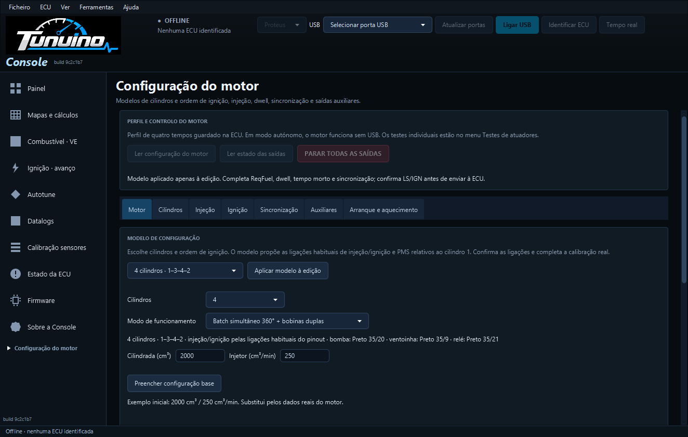
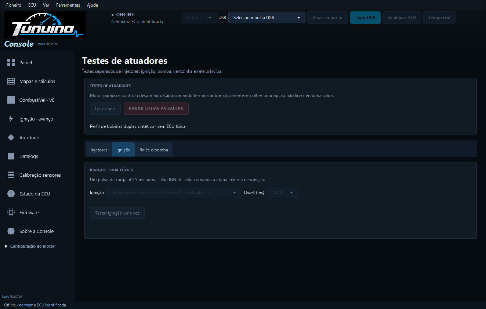
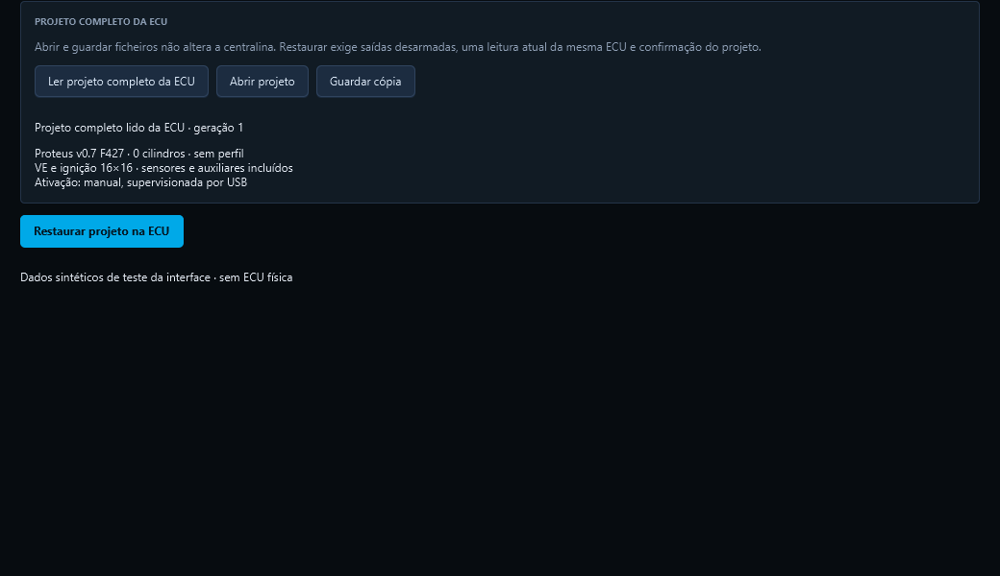

# Bobinas duplas e projeto completo da ECU

O firmware inclui modos para bobinas partilhadas por pares e um ficheiro de cópia/restauro que reúne a configuração completa da Proteus v0.7 STM32F427.

## Instalação

Instala a Console e grava na Proteus o firmware incluído na pasta `firmware` deste pacote, seguindo o [procedimento USB/DFU](console-firmware-usb.md). Atualizar apenas a Console não acrescenta os novos modos ao firmware antigo. Exporta as configurações e os mapas antes de atualizar. O instalador não grava a ECU automaticamente.

## Bobinas duplas

Em Motor e saídas → Motor, os novos modos são Semi-sequencial 360° + bobinas duplas e Batch simultâneo 360° + bobinas duplas. Exigem número par de cilindros e um par a 360° por saída de ignição. Os modos anteriores de sequencial e wasted COP continuam disponíveis.

Por exemplo, no modelo quatro cilindros 1–3–4–2, a proposta é uma bobina para 1 + 4 e outra para 2 + 3. Seleciona o modo e usa Aplicar modelo à edição para preparar os pares; confirma os contactos e completa a calibração. Selecionar o modo por si só não reescreve a cablagem guardada. O quadro Funções de I/O mostra uma função por bobina; mover essa função move os dois descritores do par. Os testes mostram uma opção por bobina, com o nome dos cilindros.

A mesma bobina não pode comandar três cilindros nem dois PMS diferentes de 360°. Os dois cilindros do par têm de usar o mesmo ajuste de avanço; combustível continua ajustável por cilindro. O firmware valida estes limites e agenda um único dwell por bobina/evento. Mantém limites, supervisão e cortes anteriores. IGN continua a ser saída lógica para a etapa de ignição adequada.

Os novos modos usam perfil formato 3. Atualizar Console, firmware e INI em conjunto antes de os selecionar. Os formatos 1/2 anteriores não são convertidos automaticamente e mantêm o funcionamento anterior. Guardar não arma saídas.

## Um ficheiro para o projeto completo

Projeto completo fica em Configuração do motor e no menu Ficheiro → ECU Project.

O ficheiro `.tnproj` reúne motor, funcionamento autónomo/manual, roda, sensores/calibrações, mapas VE/ignição, arranque/aquecimento, TPS, ralenti, turbo, combustível e proteções. O ficheiro identifica o alvo Proteus v0.7 F427 e verifica formato, integridade e compatibilidade. Os ficheiros `.tncfg`, `.tnaux` e `.tnmap` continuam suportados para as partes individuais.

### Criar uma cópia

1. Liga e identifica a ECU; termina a monitorização.
2. Abre Projeto completo e usa Ler projeto completo da ECU.
3. Usa Guardar cópia e escolhe um novo ficheiro `.tnproj`.

A leitura exige configuração sem valores pendentes. Abrir/guardar um ficheiro não altera a ECU. Um ficheiro já existente não é substituído.

### Restaurar

1. Lê o projeto atual da ECU para estabelecer a referência desta centralina.
2. Usa Abrir projeto para escolher o ficheiro a restaurar.
3. Revê o alvo, cilindros, modo e política de ativação apresentados. Pára as saídas e a monitorização.
4. Usa Restaurar projeto na ECU e confirma a substituição das quatro páginas.

Antes de preparar valores na ECU, a Console guarda uma cópia completa do estado anterior na pasta de configurações do utilizador. Recusa uma ECU trocada, configuração alterada desde a leitura, valores pendentes e saídas armadas. Prepara, valida e relê as quatro páginas, faz uma única gravação e confirma todo o projeto por nova leitura.

O motor permanece desarmado nesta sessão. Se o projeto tem política autónoma, essa política pode ativar o motor ao voltar a alimentar a ECU; aparece na confirmação. Lê o perfil em Motor e saídas antes de armar manualmente. Os outros editores invalidam as referências anteriores; lê as secções antes de guardar novas alterações.

Se houver falha ou confirmação incerta ao gravar, a mensagem identifica a fase e pede nova leitura. A Console não repete automaticamente a gravação. A cópia anterior permanece disponível.

## Capturas Windows

Capturas da Console JavaFX empacotada para Windows, build 9c2c1b7, com dados sintéticos de teste identificados como tal. Não representam ligação física à ECU.

## Verificação e limites

Os testes do controlador cobrem bobinas partilhadas entre 400 e 12 000 rpm, doze cilindros, passagem do contador pelo limite, ausência de fase de cames, rejeição de pares incorretos e de ajustes de avanço diferentes. O adaptador F427 executa os comandos e o temporizador de saídas com registos de teste.

O projeto completo foi exercitado pelo dispatcher C real e pelos clientes Java, incluindo mudanças nas quatro páginas em uma só geração, cópia anterior íntegra, projeto desatualizado, valores pendentes, saídas armadas, falha de gravação sem falso sucesso e nova tentativa só após intervenção explícita. A interface verifica as opções de pares e os bloqueios de projeto. Dados de teste são sintéticos e identificados; o ensaio elétrico e no motor continua pendente.

VVT, detonação, borboleta eletrónica, ralenti stepper, flex fuel por frequência, rodas OEM adicionais, mapa lambda 16×16, compensação barométrica, CAN/Lua e estratégias de transmissão/tração continuam pendentes.

[Teste Windows](https://github.com/Tunuino/Tunuino/actions/runs/40737664582) · [Firmware](https://github.com/Tunuino/Tunuino/actions/runs/40737664622) · [Núcleo C/Java](https://github.com/Tunuino/Tunuino/actions/runs/40737664520) · [Desktop](https://github.com/Tunuino/Tunuino/actions/runs/40737664946) · [INI](https://github.com/Tunuino/Tunuino/actions/runs/40737664669).

[Bundle e testes do instalador](https://github.com/Tunuino/Tunuino/actions/runs/40737968994): instalação limpa, atualização e preservação dos ficheiros do utilizador passaram; versão MSI verificada 1.0.114.
