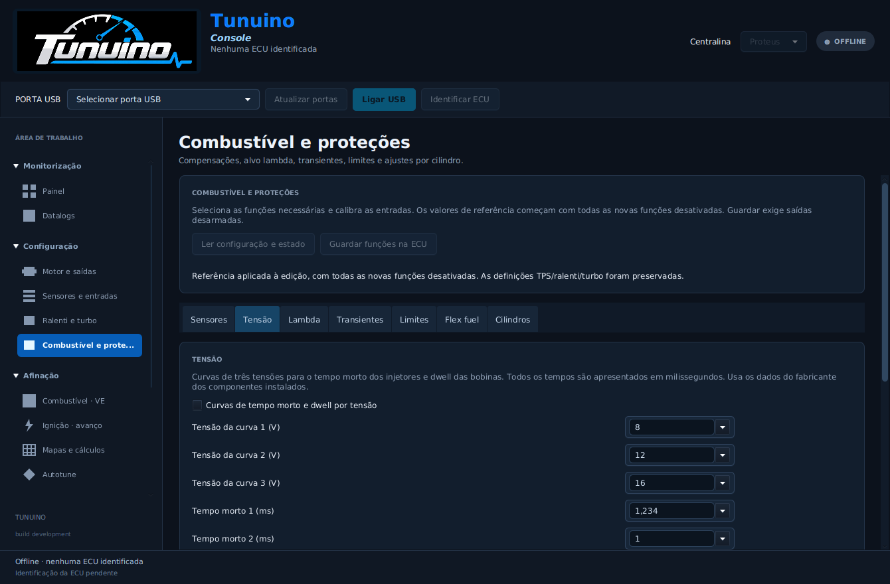
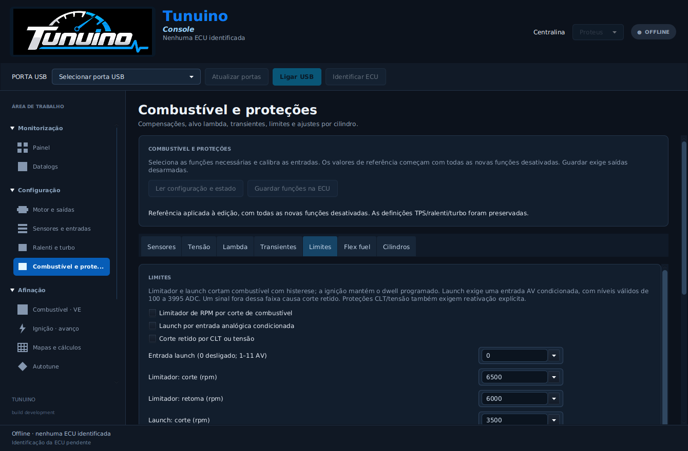

# Combustível, lambda e proteções

Esta implementação acrescenta onze estratégias opcionais ao cálculo real dos pulsos de injeção/ignição e à configuração persistente. Os testes automáticos usam relógios, sensores, flash e GPIO simulados. **Não foi realizado aqui ensaio elétrico na ECU nem ensaio num motor.**

## Onde configurar

Na Console: **Configuração → Combustível e proteções**, com sete separadores: **Sensores**, **Tensão**, **Lambda**, **Transientes**, **Limites**, **Flex fuel** e **Cilindros**. O TunerStudio recebe o menu **Fuel corrections and limits**, no INI revisão 9. Usar firmware, Console e INI do mesmo Bundle.

**Ler configuração e estado** recebe os valores da ECU. **Aplicar referência desativada** prepara valores locais para gasolina aspirada ou sobrealimentada, com todas as funções novas desligadas. As referências mantêm as definições de TPS, ralenti e turbo. As opções podem ser ativadas individualmente depois de calibrar os sensores e os componentes. O firmware valida dependências e recusa entradas partilhadas.

**Guardar funções na ECU** exige saídas desarmadas e confirma os valores por nova leitura. Guardar, abrir uma cópia ou selecionar uma referência não arma o motor. Se guardares através de outra página/aplicação, lê novamente antes de editar. Não utilizar duas aplicações na mesma COM.

## Interface

Capturas do teste automático da interface, sem ECU ligada.

## Funções implementadas

| Função | Configuração e comportamento |
|---|---|
| IAT | Curva ADC/temperatura de três pontos numa entrada TEMP independente de CLT. Corrige densidade do ar por temperatura absoluta; permite retirar avanço com ar quente, até 15°. |
| Tensão | Entrada AV calibrada em tensão real da bateria, incluindo o divisor. Curvas de três pontos para tempo morto do injetor e dwell da bobina. |
| Alvo lambda | Curva de três pontos por MAP absoluto. Corrige combustível por `1 / lambda alvo`. O mapa VE/ReqFuel deve referir-se a lambda 1 antes de ativar. |
| Lambda em malha fechada | PI com limite de correção, anti-windup, atraso após arranque, condições de CLT/RPM/TPS e pausa após transientes. Lambda inválida desativa a correção e mantém o combustível base. |
| Aceleração | Combustível adicional quando a velocidade de abertura TPS ultrapassa o limiar; redução linear ao longo da duração configurada. |
| DFCO | Corta combustível com TPS fechado, temperatura e RPM adequadas. Inclui atraso e RPM distinta de retoma. |
| Limitador de RPM | Corte de combustível e retoma com histerese, abaixo do limite máximo de aquisição já existente. |
| Launch control | Limite de RPM separado e avanço máximo enquanto a entrada AV condicionada está ativa. Requer limitador principal. Não inclui flat-shift, controlo de velocidade nem corte de ignição. |
| Flex fuel analógico | Interpola combustível e avanço entre 0 e 100% de etanol a partir de um controlador com saída analógica calibrada. Não lê diretamente o sensor de frequência. |
| Proteções CLT/tensão | Corta todas as saídas e retém a falha ao atingir CLT máxima, sair dos limites de tensão ou perder esses sinais. Exige nova ativação explícita. |
| Ajustes por cilindro | Combustível ±25%, antes do tempo morto, e avanço ±10°. Os limites finais de pulso e duty continuam ativos. |

Todos os tempos de pulso, tempo morto, dwell e combustível adicional são apresentados em **milissegundos**, com três casas decimais quando necessário. Atrasos e durações também usam ms. Por exemplo, `1,234 ms` é guardado sem arredondamento silencioso.

O alvo lambda é uma curva por pressão; não é um mapa AFR 16×16. A malha fechada corrige o comando atual, sem aprender ou reescrever a tabela VE. O estado detalhado pode ser consultado na Console; não foi acrescentado ao CSV/runtime antigo de 100 bytes.

## Entradas e calibrações

IAT utiliza TEMP1–TEMP4 e não pode partilhar a entrada de CLT. Bateria, launch e etanol usam AV1–AV11 independentes entre si e das entradas selecionadas para MAP, lambda e TPS. As tensões brutas mostradas na página ADC referem-se ao pino do MCU; a calibração da bateria deve incluir o divisor externo.

O TPS continua configurado em **Ralenti e turbo**. Aceleração, DFCO e lambda em malha fechada exigem TPS calibrado. Lambda exige uma saída analógica de controlador wideband, calibrada em **Sensores e entradas**. A correção aguarda a condição de arranque/temperatura configurada; não controla o aquecedor da sonda.

Launch exige sinal analógico condicionado: 100–3995 ADC é a faixa válida; acima do limiar configurado considera a entrada ativa. Não ligar diretamente um interruptor aos extremos da alimentação nem aplicar tensão de bateria a uma entrada sem condicionamento. A calibração deve corresponder ao circuito instalado.

As referências 400/2000/3600 ADC, curvas de tempo morto/dwell e limiares de proteção são exemplos editáveis. Não substituem medições ou especificações dos sensores, injetores e bobinas do motor.

## Ordem de aplicação e cortes

O firmware parte de ReqFuel, VE, MAP e correções de arranque/aquecimento. Aplica as compensações opcionais, acrescenta o enriquecimento transitório e o ajuste do cilindro; soma o tempo morto uma única vez. Depois verifica pulso máximo e ocupação do ciclo. Não reduz silenciosamente um pulso excessivo para o tornar aceite.

Cortes normais de RPM, launch e DFCO cancelam os pulsos dos injetores e retomam quando os seus limites/gatilhos autorizam. A ignição mantém a carga programada da bobina; o corte de combustível não encurta o dwell. A correção lambda é suspensa nesses eventos e durante a pausa configurada depois deles.

Proteção de temperatura/tensão produz uma falha retida. Falhas de sensores necessários às restantes funções ativas produzem corte de calibração. Recuperar sinal ou USB não rearma o motor. O tempo de deteção depende da aquisição e do serviço; os testes no computador não medem latência nem proteção física independente.

## Cópias e atualização

O ficheiro `.tnaux` continua com 270 bytes e inclui **TPS, ralenti, turbo e estas funções**. As duas páginas da Console preservam os campos da outra. O perfil/sensores continuam no `.tncfg` e os mapas VE/ignição nos respetivos `.tnmap`.

As configurações anteriores são lidas com as novas funções desligadas. O tamanho e os setores da flash permanecem iguais. Firmware/Console antigos rejeitam esta extensão mesmo com as opções desligadas; voltar a uma versão antiga pode recuperar um registo anterior ou valores de fábrica. Exportar todos os ficheiros antes de atualizar ou voltar a versões anteriores.

## O que continua por implementar

| Área | Estado e dependência |
|---|---|
| VVT | Falta aquisição de posição angular dos cames para controlo, modelo de atuador, estratégia PI e integração validada. A deteção atual de fase 720° não mede o comando VVT. |
| Detonação | Faltam aquisição do sinal/driver do condicionador, janelas angulares, filtragem e calibração de limiares por motor. |
| Borboleta eletrónica | Faltam comando da ponte H, pedal/TPS redundantes, supervisão de plausibilidade e reação a falhas. A calibração TPS atual não comanda uma borboleta eletrónica. |
| Flex fuel por frequência | Falta captura de frequência/largura de pulso; o suporte desta versão é analógico. |
| Ralenti stepper | Falta controlador de passos/homing; o ralenti atual é PWM de dois fios. |
| Padrões de sincronismo adicionais | Existem modelos de rodas com dentes em falta; rodas compostas/OEM exigem novos descodificadores e testes de sinais. |
| Modos de injeção/ignição adicionais | A atuação atual é sequencial 720° com fase de cames. Batch, semi-sequencial, wasted spark e distribuidor não estão implementados. |
| Afinação avançada | Faltam mapa AFR 16×16, aprendizagem VE/Autotune, correção de longo prazo, modelo de parede de combustível e compensação barométrica. |
| Integrações | Faltam controlo de motor por CAN, scripting Lua e estratégias de transmissão/tração. |

Não existe ainda equivalência completa com uma ECU de competição. As funções acima exigem desenvolvimento próprio e ensaios; não estão representadas por menus que as anunciem como prontas.

## Verificação

Os testes cobrem unidades físicas, curvas, ganhos PI, saturação, condições de ativação, temporizadores com wrap, cancelamento de injetores sem truncar dwell e corte retido. O cliente Java comunica com o adaptador C real para verificar gravação/releitura, não armação, rejeição de entradas partilhadas, snapshots antigos e escritas com saídas armadas. A migração de flash é interrompida em cada palavra programada, agora incluindo os novos campos e ajustes por cilindro.

Contrato técnico: [engine-features.md](https://github.com/Tunuino/Tunuino/blob/master/docs/engine-features.md).

## Publicação verificada — Console 1.0.99

Código publicado na `master`: [9521c2a](https://github.com/Tunuino/Tunuino/commit/9521c2a4fd25d68d4d68a94a812ea445ebb3c66f). A implementação principal está em [dcdb25d](https://github.com/Tunuino/Tunuino/commit/dcdb25dd5687854f0d9bc818ed906d12cb13e50c).

Passaram as cinco verificações de componentes: núcleo C/Java, INI/TunerStudio, interface desktop, Console Windows e firmware. A imagem F427 compilada ocupa **57 184 bytes de flash**; o tamanho não representa o número de funções ou uma validação de motor. O [Bundle 40523582738](https://github.com/Tunuino/Tunuino/actions/runs/40523582738) confirmou instalação, atualização, runtime instalado, atalhos, desinstalação e preservação dos ficheiros do utilizador. O MSI é **1.0.99**.

- [Instalador Windows x64](https://github.com/Tunuino/Tunuino/releases/download/nightly-2026-10-27-40523915827/tunuino_setup_windows_x64.msi)
- [Bundle portátil ZIP](https://github.com/Tunuino/Tunuino/releases/download/nightly-2026-10-27-40523915827/tunuino_bundle_proteus_v07_f427_usb_bench.zip)
- [Release com firmware, Console e INI do mesmo commit](https://github.com/Tunuino/Tunuino/releases/tag/nightly-2026-10-27-40523915827)

Os nomes históricos dos ficheiros mantêm `usb_bench`. O firmware já contém controlo de motor e as estratégias descritas; o nome não significa que estas funções se resumam a uma simulação. A validação aqui apresentada continua a ser de compilação, protocolo, interface, instalação e modelos de hardware no computador.
