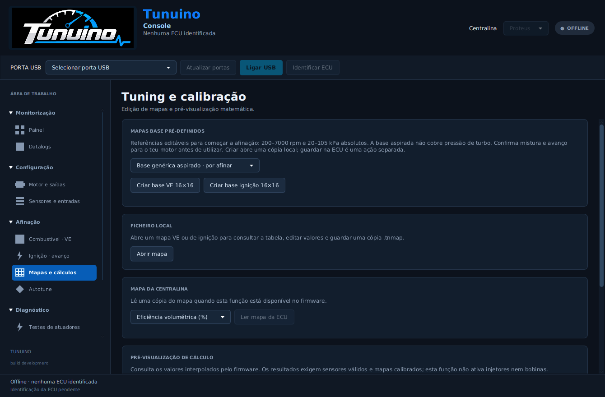
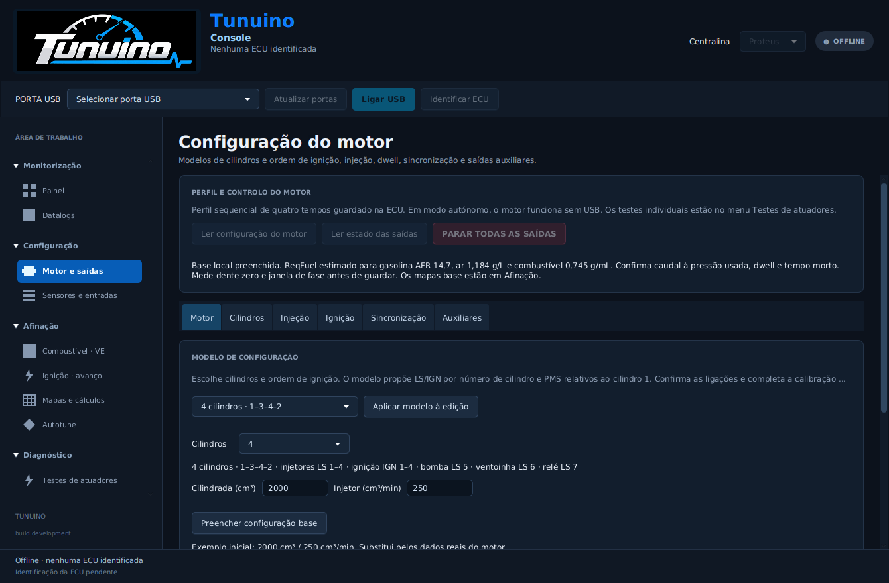

> Atualização: [combustível, lambda, transientes, limites e funções pendentes](combustivel-protecoes.md). As novas opções ficam desativadas até configuração explícita.

> Atualização: [TPS, ralenti PWM e controlo de turbo](ralenti-turbo-tps.md), com migração da flash e cópia `.tnaux` separada.

# Configuração persistente e mapas base

A Console passa a guardar o perfil do motor na flash, juntamente com sensores e mapas. A política autónoma permite ativar o perfil guardado ao ligar a alimentação e manter o funcionamento sem computador. A configuração de fábrica continua sem perfil ativo. Esta revisão não equivale ainda a uma gestão de motor completa e validada fisicamente.

## Começar pela base

1. Em **Motor e saídas → Motor**, escolher cilindros e ordem de ignição. Introduzir cilindrada e caudal real dos injetores e usar **Preencher configuração base**.
2. A base propõe atribuições LS/IGN, ReqFuel estimado, dwell de 3 ms, tempo morto de 1 ms, pulso máximo de 20 ms, escorva de 2000 ms e ventoinha 95/90 °C. São valores iniciais editáveis, não especificações universais das cargas. A referência do dente zero e a janela de fase exigem medição/configuração do motor real.
3. Em **Mapas e cálculos**, escolher **Base genérica aspirado** ou **Referência plana** e criar VE/ignição 16×16. Também há **Criar mapa base** nas páginas de tabelas. Abre uma cópia local no editor, sem escrita automática. Com ECU ligada, o envio separado exige confirmação e leitura de verificação.
4. A base aspirada cobre 200–7000 rpm e 20–105 kPa absolutos. Não contém afinação para turbo. A referência plana usa VE 80% e avanço 10°. Ambas exigem ajustar mistura e avanço ao motor. Não são mapas de arranque certificados.
5. Configurar roda fónica, curvas reais de MAP/temperatura e entradas. Guardar os dois mapas e o perfil do motor. A ativação autónoma exige perfil válido, captura, MAP, temperatura e todas as células VE preenchidas.

ReqFuel é uma estimativa de massa de ar/combustível para gasolina AFR 14,7, densidade de ar 1,184 g/L e combustível 0,745 g/mL. O caudal deve corresponder à pressão diferencial usada. A estimativa não inclui compensação de tensão ou IAT. As correções de arranque/aquecimento são configuradas num separador próprio, descrito abaixo. Não usar os valores do exemplo 2000 cm³ / 250 cm³/min como dados do motor sem os confirmar.

## Tempos em milissegundos

Injeção, dwell e tempo morto aparecem em **ms**, com resolução de 0,001 ms. O formulário aceita ponto ou vírgula decimal; 2,5 ms é convertido exatamente para o temporizador. Testes individuais e estado das saídas também usam ms. A representação interna preserva a resolução original.

## Guardar e usar sem USB

**Guardar motor na ECU** valida, grava e lê novamente os valores. A operação deixa as saídas desarmadas. **Ler configuração do motor** recupera o perfil depois de desligar/religar a ECU. O backup `.tncfg` inclui o perfil e a política de ativação; os mapas são ficheiros separados.

No modo manual, a ativação é explícita e há supervisão USB de dois segundos. No modo autónomo, o próximo arranque elétrico ativa o perfil guardado e a USB não determina a continuidade do motor. Uma reconexão USB não reinicia a captura nem arma saídas. A espera de recuperação USB de 250 ms já não bloqueia o serviço do motor.

**PARAR TODAS AS SAÍDAS** e as falhas mantêm o corte até nova ativação explícita ou reinício elétrico. Não há recuperação automática de um motor parado por perda de sincronismo. As escritas e Burn são recusados enquanto armado; esta revisão não permite afinação em funcionamento.

## TunerStudio

O INI desta revisão acrescenta motor/política de ativação, cilindros/saídas/PMS, ReqFuel, dwell, tempo morto, limite de pulso, sincronização, bomba, ventoinha e relé. Os botões de ativação/paragem usam o perfil guardado. O estado distingue espera de fase, sequencial, falha e teste. Atualizar firmware, Console e INI em conjunto. Os modelos estruturais da Console podem ser guardados na ECU e lidos pelo TunerStudio.

As configurações anteriores de esquema 2 são preservadas e continuam com o perfil de motor desativado. Os nomes históricos dos ficheiros do Bundle ainda incluem `usb-bench`; isso não determina a política de funcionamento.

## Validação e trabalho ainda necessário

Testes de código executam o adaptador real com GPIO/temporizadores simulados, independência de consultas USB, recusa de escritas com saídas ativas, corte e paragem sem reativação automática, recuperação USB com serviço contínuo, gravação interrompida em cada palavra do registo, leitura C/Java, backups e conversão exata de ms. A interface é exercitada por JavaFX; a compilação F427 e a instalação Windows são verificadas no CI.

**Não foram realizados aqui ensaios elétricos nem ensaios num motor.** Faltam ainda controlo VVT, detonação, flex fuel, launch control, Lua, compensações IAT/tensão e enriquecimento de aceleração, entre outras funções. Os menus desta versão só representam funções existentes.

Implementação: [commit ab6da89](https://github.com/Tunuino/Tunuino/commit/ab6da89cc1bca8f34d7c09f95b7eafe7b192ee81). Todos os testes do commit passaram e o [pacote correspondente foi publicado](https://github.com/Tunuino/Tunuino/releases/tag/nightly-2026-10-27-40463353146).

## Arranque e aquecimento

A implementação seguinte acrescenta combustível de arranque, enriquecimento após arranque com duração em ms, curva de aquecimento e avanço fixo de arranque opcional. [Configuração, exemplos e limites](arranque-aquecimento.md).

