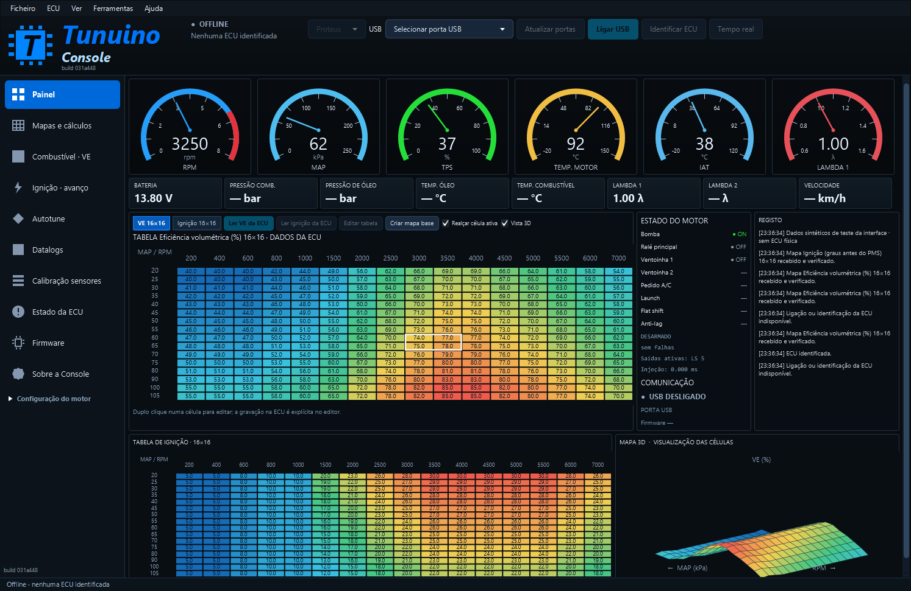
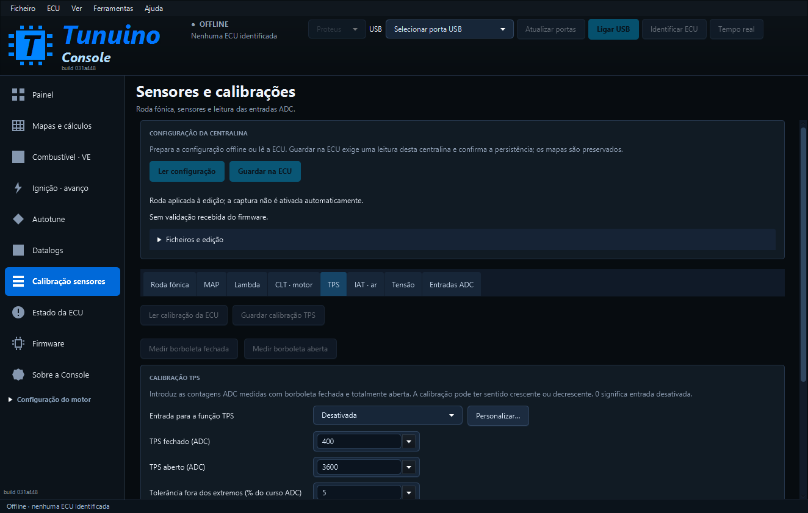
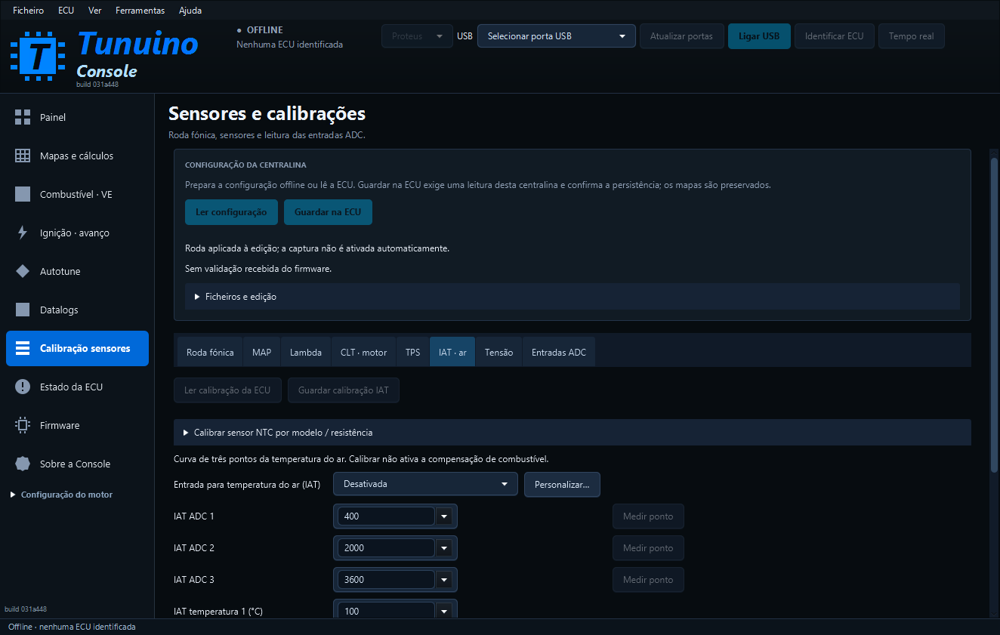
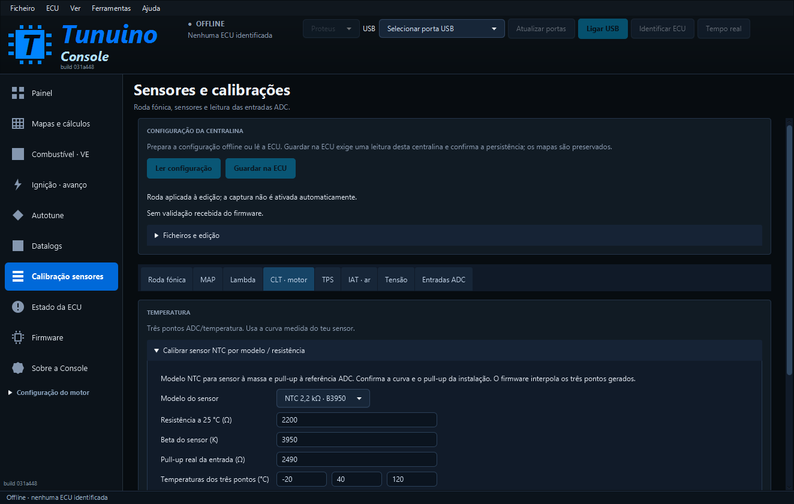

> Atualização: [correção do firmware para a queda USB ao guardar na ECU](correcao-gravacao-usb.md).

# Console: painel, calibrações e estabilidade USB

**Console 1.0.105 · build 031a448**, para Proteus v0.7 STM32F427. Publicação de 28 de outubro de 2026.

[Instalador Windows](https://github.com/Tunuino/Tunuino/releases/download/nightly-2026-10-27-40603513940/tunuino_setup_windows_x64.msi) · [Bundle e notas da versão](https://github.com/Tunuino/Tunuino/releases/tag/nightly-2026-10-27-40603513940).

## Painel de afinação

A disposição segue a referência visual aprovada: navegação principal plana, seis mostradores numa fila, oito indicadores, tabela VE 16×16, estado do motor e registo em colunas à direita, tabela de ignição e superfície 3D em baixo. A área adicional Configuração do motor contém motor/saídas, funções de I/O, ralenti/turbo, combustível/proteções e testes de atuadores.

Os mostradores são RPM, MAP, TPS, temperatura do motor, temperatura do ar e lambda. A monitorização USB recebe também TPS, IAT, tensão e estado das saídas através do protocolo nativo já existente. A ligação de cada relé é obtida do perfil guardado, sem assumir contactos fixos. Parar a monitorização limpa as leituras atuais. Canais não recebidos, como pressão de óleo/combustível, segunda lambda ou velocidade, ficam sem valor.

O botão Tempo real / Parar dados está no cabeçalho para controlar a monitorização sem mudar de página. A configuração mantém a sessão USB exclusiva; para alterar calibrações, termina primeiro a monitorização nesse botão.

## Capturas da aplicação Windows

Estas são imagens da Console JavaFX empacotada, com o build identificado no cabeçalho. Os mostradores e mapas coloridos usam dados sintéticos de teste; não são uma ligação física nem uma afinação validada para um motor.

## Sensores e calibrações

Os seis sensores suportados ficam na mesma área, com os separadores Roda fónica, MAP, Lambda, CLT · motor, TPS, IAT · ar, Tensão e Entradas ADC.

| Sensor | Calibração disponível |
|---|---|
| MAP | Dois pontos ADC/pressão em kPa, modelos lineares editáveis e Medir ponto |
| Lambda | Dois pontos ADC/lambda do controlador wideband, referências lineares e Medir ponto |
| CLT | Três pontos ADC/°C, Medir ponto e assistente NTC |
| TPS | Extremos fechado/aberto, medição de cada extremo e tolerância; curso crescente ou decrescente |
| IAT | Três pontos ADC/°C, Medir ponto e assistente NTC |
| Tensão | Dois pontos ADC/volts da bateria, medidos com multímetro |

### Medir e guardar

1. Liga e identifica a ECU. Termina a monitorização em Parar dados.
2. Abre o sensor e lê a calibração da ECU nessa secção. Escolhe a ligação que corresponde à instalação.
3. Coloca o sensor numa condição conhecida e usa Medir ponto. A Console lê o ADC dessa ligação; uma leitura inválida não altera o ponto.
4. Introduz o valor físico conhecido: pressão, lambda, temperatura ou tensão. No TPS, mede a posição totalmente fechada e a posição totalmente aberta.
5. Guarda a calibração. O protocolo valida, grava e confirma os valores por releitura. Guardar não arma saídas nem ativa compensações.

TPS, IAT e tensão têm gravação própria, que preserva os restantes parâmetros, modos de ralenti/turbo e proteções. As secções acompanham as revisões guardadas quando o conteúdo que lhes pertence foi preservado. Uma alteração incompatível obriga a nova leitura, mantendo a edição local até essa leitura explícita.

Os ficheiros .tncfg contêm a página de sensores principais/perfil; .tnaux contém auxiliares e funções, incluindo TPS, IAT e tensão. O botão Ficheiros e edição conserva abrir/guardar/repor da configuração principal.

### Modelos NTC

O assistente permite escolher os modelos matemáticos NTC 2,2 kΩ/B3950 e NTC 10 kΩ/B3950 ou introduzir R25 e Beta próprios. A resistência de pull-up e as três temperaturas são editáveis. O modelo pressupõe NTC à massa e polarização à referência ADC, ou condicionamento ratiométrico equivalente.

Confirma os dados do sensor e do circuito. Os valores apresentados são referências editáveis; não identificam automaticamente o sensor nem validam o pull-up da placa. A Console calcula e ordena três pontos por ADC; o firmware continua a interpolar esses três pontos. Escolher o modelo só prepara a edição, mantendo a entrada desativada se ainda não estava atribuída.

Para uma ligação/condicionamento diferente, usa os pontos ADC medidos em condições conhecidas. A tensão AV é a tensão já condicionada pelo circuito; a calibração não transforma uma entrada ADC numa entrada direta de 12 V.

## Correção do piscar em Firmware

Foram separadas duas tarefas que alternavam indevidamente o estado da interface:

- A pesquisa DFU deixava a página ocupada a cada três segundos e reconstruía a lista, mesmo sem alteração dos dispositivos.
- A pesquisa COM automática usava a fila de transações exclusivas, alternando o estado dos controlos de configuração.

A descoberta automática passa a correr em segundo plano sem bloquear os controlos. A DFU pausa quando a página não está apresentada ou quando a COM está ocupada. Resultados inalterados preservam a lista, o número de série selecionado e uma lista aberta. A gravação de firmware e a instalação de drivers mantêm a exclusão necessária às operações reais.

Não há mudança automática de firmware, drivers ou modo de arranque ao abrir a página.

## Testes e limites

Passaram os testes locais do núcleo C/Java, conversão/calibração, preservação byte a byte de parâmetros alheios ao sensor, captura inválida e decimais com vírgula. O teste integrado usa o adaptador de saídas compilado para o computador e verifica a leitura adicional de sensores/estado/perfil no mesmo fluxo série. O peer antigo sem extensão continua a receber os canais base.

A interface percorre as páginas reais, verifica os 50 seletores de ligação, testa a pesquisa DFU assíncrona e confirma que dez resultados iguais preservam itens, seleção e lista aberta. Estas verificações e capturas usam dados sintéticos. Continuam pendentes os ensaios físicos na ECU do utilizador e a validação das curvas de cada sensor instalado.

Autotune, VVT, controlo de detonação, borboleta eletrónica e sensores adicionais continuam a exigir implementação e validação próprias. Esta publicação corrige os percursos descritos; não declara essas funções operacionais.

Código: [031a448](https://github.com/Tunuino/Tunuino/commit/031a448e71fd11b7a7e08d1b2010c0288978fbba), com a implementação funcional em [202ab2c](https://github.com/Tunuino/Tunuino/commit/202ab2c7ddb8ea675f07a31c5a1e46ef0e1b7958). Passaram [Console Windows](https://github.com/Tunuino/Tunuino/actions/runs/40603181525), [interface Linux/simulador](https://github.com/Tunuino/Tunuino/actions/runs/40603181401), testes unitários, firmware e validação do INI para o mesmo commit.

O [Bundle 40603328892](https://github.com/Tunuino/Tunuino/actions/runs/40603328892) verificou o MSI **1.0.105**: instalação, conteúdo instalado/runtime, atalhos, atualização, desinstalação e preservação de ficheiros do utilizador. O cabeçalho identifica **build 031a448** no executável desta publicação.
