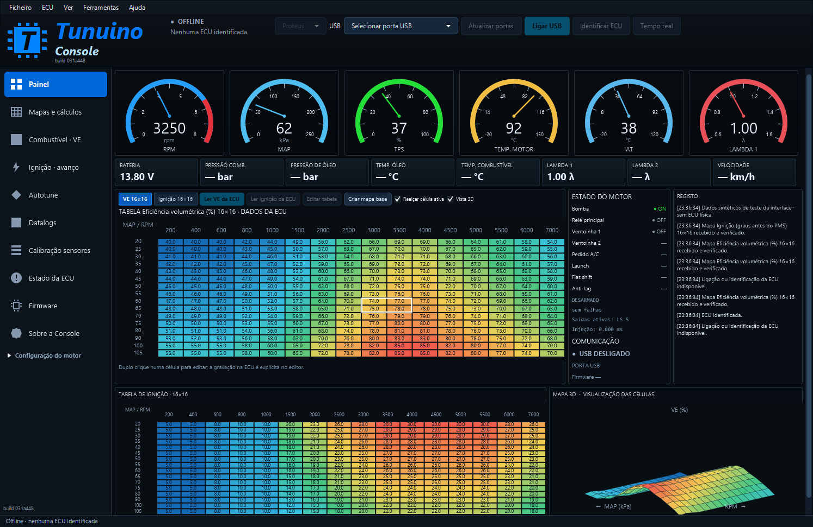
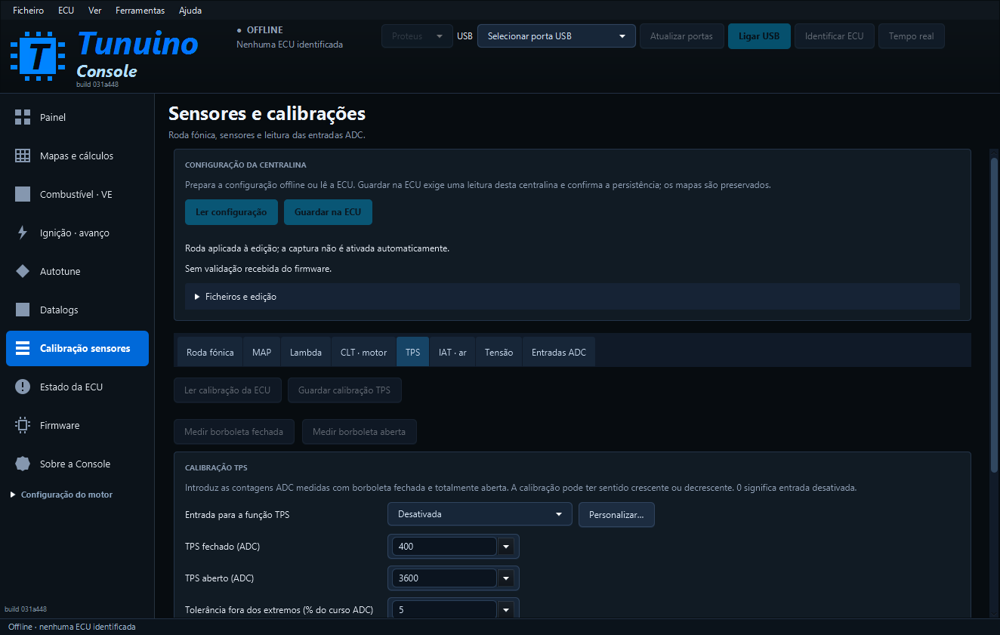
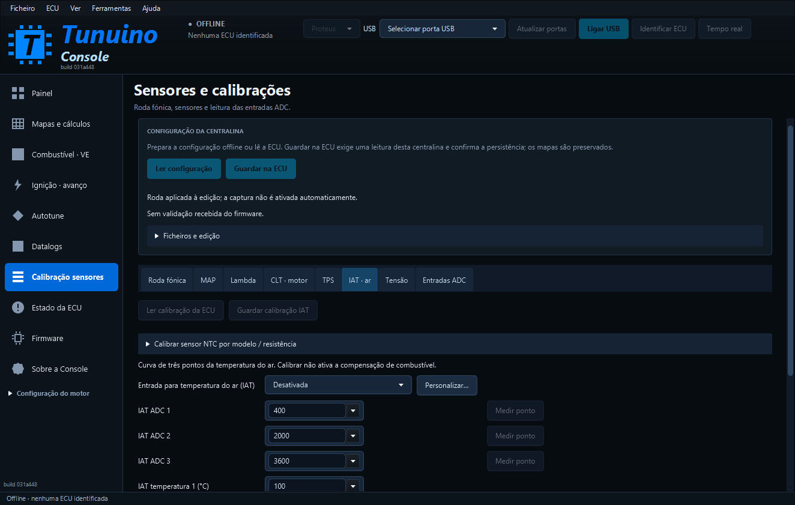
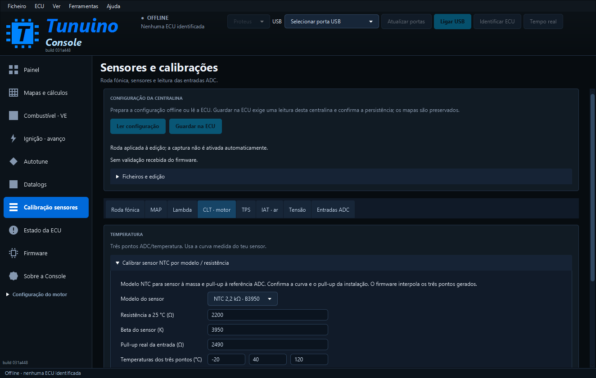

# Sensores e calibrações na Console Qt

A versão Qt atual lê automaticamente MAP, CLT, Lambda, TPS, IAT e tensão da bateria da ECU, permite editar a calibração e guarda cada sensor por **Write to ECU** ou **ECU → Write to ECU / F2** com a página do sensor ativa. As imagens JavaFX mais abaixo são históricas e não representam a versão Qt atual.

| Sensor | Edição atual |
|---|---|
| MAP | Dois pontos de tensão no conector / pressão em kPa |
| CLT | Três pontos de tensão no conector / temperatura em °C |
| Lambda | Dois pontos tensão/lambda; perfis por modelo de controlador e curva personalizada |
| TPS | Captura de borboleta fechada e aberta; curso crescente ou decrescente |
| IAT | Três pontos de tensão no conector / temperatura em °C |
| Bateria | Dois pontos de tensão condicionada / tensão medida com multímetro |

A escolha normal mostra Desativada e a ligação atual. **Customise input** abre os contactos AV1–AV11 ou AT1–AT4 do conector J103 da Proteus v0.7. As correspondências foram conferidas no PCB revisão 383558bf7ca1c53ad8bbd8fdc9dd3a4187013c46. Uma entrada ocupada por outra função é recusada ao validar a edição; não se desloca a função existente.

A captura usa o ADC real da entrada selecionada. Exige amostra válida da mesma ECU e geração, recebida há no máximo dois segundos. A tensão apresentada corresponde ao conector, usando o divisor nominal 5,6 kΩ/10 kΩ da placa e a referência ADC guardada na configuração; não é uma medição independente por multímetro. As pressões e temperaturas de referência devem corresponder à condição conhecida do sensor instalado.

Escolher um perfil Lambda apenas prepara os pontos; não escolhe a cablagem nem grava. Confirmar o modelo e a saída analógica configurada. Os valores são guardados em lambda, com três casas decimais. TPS, IAT e bateria no estado do motor e no Graph Log são calculados a partir do ADC selecionado e da calibração lida da mesma ECU e geração. Os dois novos canais usam a interpolação inteira e os limites da curva usados no firmware. ADC inválido, entrada desativada ou leitura fora da curva ficam indisponíveis, incluindo no CSV.

A gravação exige motor parado, alimentação externa e saídas desarmadas. Confirma identidade/geração/base, preserva uma cópia interna da configuração anterior, altera apenas os campos do sensor, relê as quatro páginas, envia uma única gravação permanente e volta a confirmar todas as páginas. Não ativa estratégias ou saídas. A primeira configuração TPS pode inicializar uma página auxiliar vazia com todos os controlos desativados. A tolerância TPS existente é preservada. A primeira calibração IAT ou de bateria pode inicializar a extensão auxiliar vazia com os controlos desativados. Os flags existentes de compensação/proteção são preservados; desativar uma entrada necessária a uma função ativa é recusado.

Passaram a compilação local Qt e os seis testes CTest. SensorCalibrationTest cobre conversão, conflitos, preservação de campos, TPS invertido, captura real simulada, rejeição de amostras antigas/inválidas e conservação de edições locais. As seis gravações passaram também contra o dispatcher e os módulos C de Tunuino_Firmware fac3da2214abdea9bbeda3d0be42f4ae87bfb48e, com persistência e saídas simuladas no computador. O ensaio foi repetido começando por IAT e começando por bateria: doze gravações de sensores, incluindo inicialização de página vazia e confirmação integral das quatro páginas. Os testes verificam ainda canais ocupados com compensação desativada, preservação dos flags e captura do ADC correto nos dois painéis. **Ainda falta validação física na Proteus**, incluindo flash, USB e precisão dos sensores.

A medição de bateria configurável usa AV1–AV11 e exige um divisor externo adequado. Introduzir a tensão condicionada no conector e a tensão real medida por multímetro. Não ligar a bateria diretamente a uma entrada AV. Este canal é independente da deteção interna de alimentação externa usada na ligação automática.

A compilação e o instalador Windows da versão anterior passaram no [workflow 42232511531](https://github.com/Tunuino/Tunuino/actions/runs/42232511531). Esta atualização tem a sua própria compilação Windows.

## Registo histórico JavaFX

## Painel de afinação

A disposição segue a referência visual aprovada: navegação principal plana, seis mostradores numa fila, oito indicadores, tabela VE 16×16, estado do motor e registo em colunas à direita, tabela de ignição e superfície 3D em baixo. A área adicional Configuração do motor contém motor/saídas, funções de I/O, ralenti/turbo, combustível/proteções e testes de atuadores.

Os mostradores são RPM, MAP, TPS, temperatura do motor, temperatura do ar e lambda. A monitorização USB recebe também TPS, IAT, tensão e estado das saídas através do protocolo nativo já existente. A ligação de cada relé é obtida do perfil guardado, sem assumir contactos fixos. Parar a monitorização limpa as leituras atuais. Canais não recebidos, como pressão de óleo/combustível, segunda lambda ou velocidade, ficam sem valor.

O botão Tempo real / Parar dados está no cabeçalho para controlar a monitorização sem mudar de página. A configuração mantém a sessão USB exclusiva; para alterar calibrações, termina primeiro a monitorização nesse botão.

## Capturas da aplicação Windows

Estas são imagens da Console JavaFX empacotada, com o build identificado no cabeçalho. Os mostradores e mapas coloridos usam dados sintéticos de teste; não são uma ligação física nem uma afinação validada para um motor.

## Sensores e calibrações

Os seis sensores suportados ficam na mesma área, com os separadores Roda fónica, MAP, Lambda, CLT · motor, TPS, IAT · ar, Tensão e Entradas ADC.

| Sensor | Calibração disponível |
|---|---|
| MAP | Dois pontos ADC/pressão em kPa, modelos lineares editáveis e Medir ponto |
| Lambda | Dois pontos ADC/lambda do controlador wideband, referências lineares e Medir ponto |
| CLT | Três pontos ADC/°C, Medir ponto e assistente NTC |
| TPS | Extremos fechado/aberto, medição de cada extremo e tolerância; curso crescente ou decrescente |
| IAT | Três pontos ADC/°C, Medir ponto e assistente NTC |
| Tensão | Dois pontos ADC/volts da bateria, medidos com multímetro |

### Medir e guardar

1. Liga e identifica a ECU. Termina a monitorização em Parar dados.
2. Abre o sensor e lê a calibração da ECU nessa secção. Escolhe a ligação que corresponde à instalação.
3. Coloca o sensor numa condição conhecida e usa Medir ponto. A Console lê o ADC dessa ligação; uma leitura inválida não altera o ponto.
4. Introduz o valor físico conhecido: pressão, lambda, temperatura ou tensão. No TPS, mede a posição totalmente fechada e a posição totalmente aberta.
5. Guarda a calibração. O protocolo valida, grava e confirma os valores por releitura. Guardar não arma saídas nem ativa compensações.

TPS, IAT e tensão têm gravação própria, que preserva os restantes parâmetros, modos de ralenti/turbo e proteções. As secções acompanham as revisões guardadas quando o conteúdo que lhes pertence foi preservado. Uma alteração incompatível obriga a nova leitura, mantendo a edição local até essa leitura explícita.

Os ficheiros .tncfg contêm a página de sensores principais/perfil; .tnaux contém auxiliares e funções, incluindo TPS, IAT e tensão. O botão Ficheiros e edição conserva abrir/guardar/repor da configuração principal.

### Modelos NTC

O assistente permite escolher os modelos matemáticos NTC 2,2 kΩ/B3950 e NTC 10 kΩ/B3950 ou introduzir R25 e Beta próprios. A resistência de pull-up e as três temperaturas são editáveis. O modelo pressupõe NTC à massa e polarização à referência ADC, ou condicionamento ratiométrico equivalente.

Confirma os dados do sensor e do circuito. Os valores apresentados são referências editáveis; não identificam automaticamente o sensor nem validam o pull-up da placa. A Console calcula e ordena três pontos por ADC; o firmware continua a interpolar esses três pontos. Escolher o modelo só prepara a edição, mantendo a entrada desativada se ainda não estava atribuída.

Para uma ligação/condicionamento diferente, usa os pontos ADC medidos em condições conhecidas. A tensão AV é a tensão já condicionada pelo circuito; a calibração não transforma uma entrada ADC numa entrada direta de 12 V.

## Correção do piscar em Firmware

Foram separadas duas tarefas que alternavam indevidamente o estado da interface:

- A pesquisa DFU deixava a página ocupada a cada três segundos e reconstruía a lista, mesmo sem alteração dos dispositivos.
- A pesquisa COM automática usava a fila de transações exclusivas, alternando o estado dos controlos de configuração.

A descoberta automática passa a correr em segundo plano sem bloquear os controlos. A DFU pausa quando a página não está apresentada ou quando a COM está ocupada. Resultados inalterados preservam a lista, o número de série selecionado e uma lista aberta. A gravação de firmware e a instalação de drivers mantêm a exclusão necessária às operações reais.

Não há mudança automática de firmware, drivers ou modo de arranque ao abrir a página.

## Testes e limites

Passaram os testes locais do núcleo C/Java, conversão/calibração, preservação byte a byte de parâmetros alheios ao sensor, captura inválida e decimais com vírgula. O teste integrado usa o adaptador de saídas compilado para o computador e verifica a leitura adicional de sensores/estado/perfil no mesmo fluxo série. O peer antigo sem extensão continua a receber os canais base.

A interface percorre as páginas reais, verifica os 50 seletores de ligação, testa a pesquisa DFU assíncrona e confirma que dez resultados iguais preservam itens, seleção e lista aberta. Estas verificações e capturas usam dados sintéticos. Continuam pendentes os ensaios físicos na ECU do utilizador e a validação das curvas de cada sensor instalado.

Autotune, VVT, controlo de detonação, borboleta eletrónica e sensores adicionais continuam a exigir implementação e validação próprias. Esta publicação corrige os percursos descritos; não declara essas funções operacionais.

O [Bundle 40603328892](https://github.com/Tunuino/Tunuino/actions/runs/40603328892) verificou o MSI **1.0.105**: instalação, conteúdo instalado/runtime, atalhos, atualização, desinstalação e preservação de ficheiros do utilizador. O cabeçalho identifica **build 031a448** no executável desta publicação.
