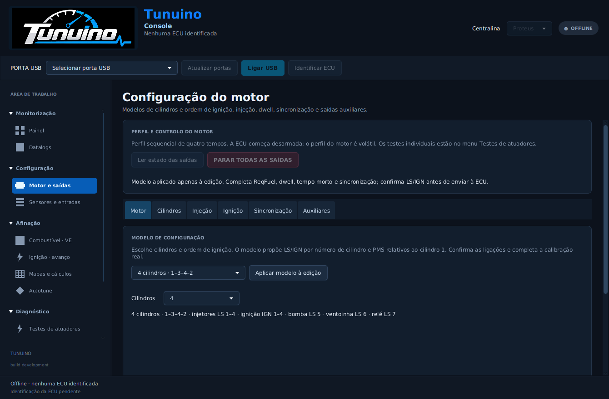
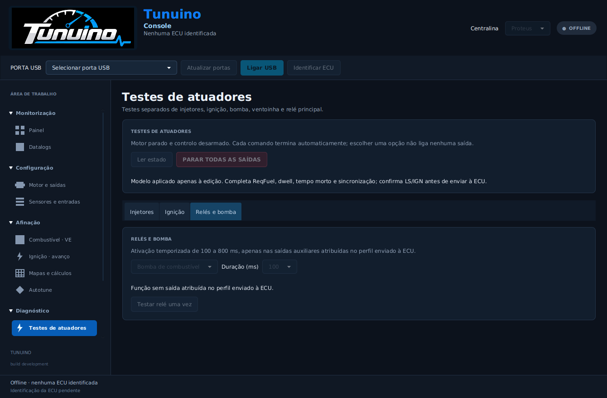
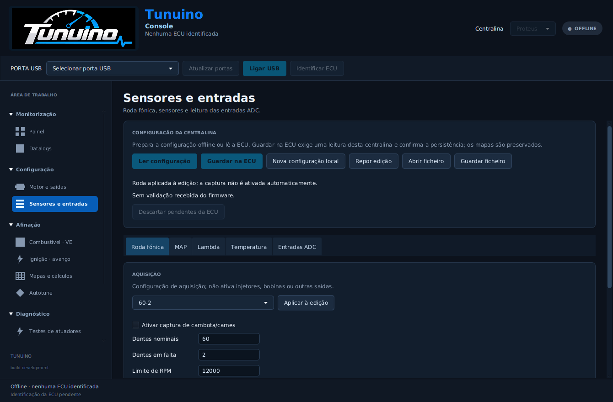

> Atualização: [perfil persistente, funcionamento autónomo, mapas base e tempos em ms](configuracao-persistente-mapas-base.md). As referências anteriores a perfil volátil aplicam-se às versões antigas.

# Menus, modelos e testes de atuadores

A Console separa agora a configuração do motor, a calibração dos sensores e os ensaios físicos de saídas. A navegação usa grupos expansíveis com nomes em português.

| Grupo | Páginas |
|---|---|
| Monitorização | Painel, Datalogs |
| Configuração | Motor e saídas, Sensores e entradas |
| Afinação | Combustível · VE, Ignição · avanço, Mapas e cálculos, Autotune |
| Diagnóstico | Testes de atuadores, Estado da ECU |
| Sistema | Firmware, Sobre a Console |

Autotune continua identificado como indisponível; esta alteração não implementa afinação automática.

## Modelos de configuração

Em **Configuração → Motor e saídas → Motor**, escolher o modelo e usar **Aplicar modelo à edição**. Existem modelos de 1, 2, 3, 4, 5, 6 e 8 cilindros, incluindo duas ordens para quatro cilindros: 1–3–4–2 e 1–2–4–3. Os modelos pressupõem intervalos iguais num ciclo de quatro tempos. A configuração manual continua a aceitar até 12 cilindros e ângulos PMS individuais.

O modelo preenche o número de cilindros, os PMS relativos ao cilindro 1 e propõe saídas LS/IGN por número de cilindro, reservando saídas diferentes para bomba, ventoinha e relé principal. As atribuições têm de corresponder à cablagem. ReqFuel, dwell, tempo morto e referência de sincronização exigem os valores reais do motor e das cargas. O modelo é estrutural; o preenchimento desses parâmetros continua explícito.

Os parâmetros estão divididos em separadores **Motor**, **Cilindros**, **Injeção**, **Ignição**, **Sincronização** e **Auxiliares**. Há listas de valores editáveis para temporizações e saídas. Apenas são mostradas as linhas dos cilindros selecionados.

Em **Sensores e entradas**, os separadores são **Roda fónica**, **MAP**, **Lambda**, **Temperatura** e **Entradas ADC**. Existem escolhas de rodas 36-1, 60-2, 24-1 e 12-1 e modelos de curvas lineares ADC para MAP e lambda. Os pontos desses modelos são expressos no ADC da MCU; devem ser ajustados ao sensor/controlador e aos divisores da instalação. A temperatura continua a exigir a curva real de três pontos.

A edição local e os ficheiros `.tncfg` estão disponíveis sem ECU. As entradas começam desativadas. Para aplicar à ECU, é necessário identificar e ler essa centralina; a gravação valida, persiste e confirma os valores. Aplicar um modelo ou escolher uma saída não envia um comando físico.

## Testes de atuadores

**Diagnóstico → Testes de atuadores** tem três separadores próprios:

| Teste | Escolhas e limites |
|---|---|
| Injetores | LS 1–16, um pulso de 1–20 ms |
| Ignição | IGN 1–12, um pulso de carga de 1–5 ms |
| Relés e bomba | Bomba de combustível, ventoinha ou relé principal; 100, 250, 500 ou 800 ms |

Cada comando tem confirmação, termina automaticamente e dispõe de **PARAR TODAS AS SAÍDAS**. O motor tem de estar parado e desarmado. Os testes de relés exigem um perfil enviado nesta sessão e só são aceites nas saídas auxiliares efetivamente atribuídas nesse perfil. O firmware recusa temporizações de relé nas saídas de injetores/ignição, numa calibração pendente ou com outra revisão. O temporizador da placa encerra o pulso independentemente do computador, e a deteção de rotação corta o ensaio.

Os testes de relés requerem o firmware e a Console do mesmo lançamento. O perfil do motor permanece volátil e começa desarmado após reiniciar a ECU.

## Verificação

Os ensaios C/Java incluem ordem dos cilindros, fases de 720°, edição offline, limites de pulso, encaminhamento das saídas, cortes, duração do teste de relé e passagem do contador por zero. Os testes de interface percorrem os novos menus e os modelos e verificam os bloqueios offline. As capturas de interface usam dados de teste e não uma ECU ligada. O comportamento elétrico dos novos testes temporizados ainda exige ensaio na placa.

## Capturas da interface

Capturas da aplicação em teste automatizado, sem ECU física ligada.

## Lançamento validado

O instalador **1.0.93** e o ZIP de testes foram [publicados juntos](https://github.com/Tunuino/Tunuino/releases/tag/nightly-2026-10-26-40388373649), no commit `3fa168d35bc5cc0a79db14d31c69caf20456253d`. A Console Windows, a interface em janelas compactas, o firmware F427, o núcleo C/Java e as definições TunerStudio passaram. O [ensaio do instalador no Windows](https://github.com/Tunuino/Tunuino/actions/runs/40388042961) confirmou instalação, atualização, atalhos, runtime, desinstalação e preservação dos ficheiros do utilizador.

A compilação e os testes simulados não substituem o teste elétrico dos novos pulsos temporizados na Proteus.
