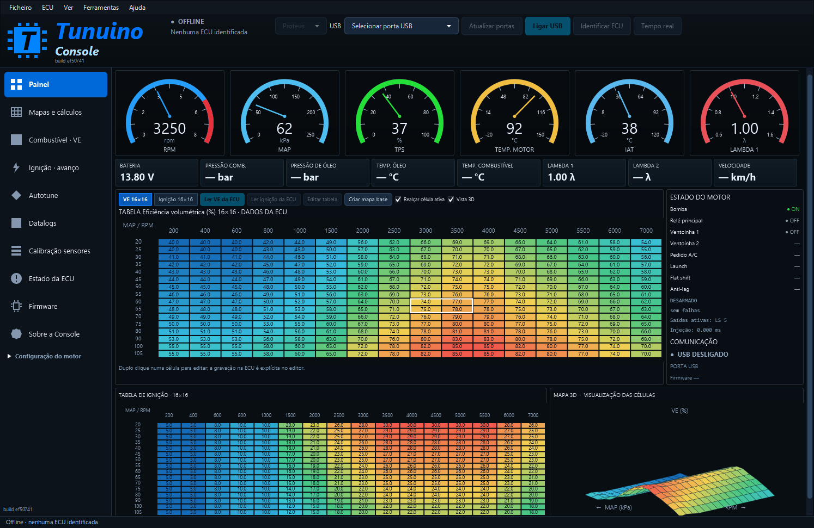

# Painel: apenas Estado do motor

**Console 1.0.107 · build ef50741.**

[Instalador Windows](https://github.com/Tunuino/Tunuino/releases/download/nightly-2026-10-28-40610177017/tunuino_setup_windows_x64.msi) · [Bundle e notas da versão](https://github.com/Tunuino/Tunuino/releases/tag/nightly-2026-10-28-40610177017).

A coluna Registo foi retirada do Painel e das páginas Combustível · VE e Ignição · avanço. À direita fica apenas Estado do motor, incluindo saídas, falhas, comunicação, porta e versão de firmware. A tabela ocupa agora 80% da largura central.

A página Datalog continua disponível. As confirmações e os erros das operações continuam nos respetivos controlos e na barra de estado.

Esta alteração aplica-se ao atualizar a Console. O firmware conserva a correção USB ao guardar mapas, descrita em [Gravação na ECU](correcao-gravacao-usb.md); essa correção exige gravar o firmware atualizado.

## Captura Windows

Captura da Console JavaFX empacotada para Windows, build ef50741, com dados sintéticos de teste e sem ligação a uma ECU.

## Verificação

A aplicação JavaFX real passou na navegação entre páginas, leitura/edição de mapas, dimensões compactas e grandes, calibrações e descoberta de dispositivos. Os testes usam dados sintéticos, sem ECU física.

Código: [ef50741](https://github.com/Tunuino/Tunuino/commit/ef50741bcc025dcece3a43f5499bc66bdf404f24).

[Teste Windows](https://github.com/Tunuino/Tunuino/actions/runs/40609840133) · [Desktop e simulador](https://github.com/Tunuino/Tunuino/actions/runs/40609840138) · [Testes do núcleo](https://github.com/Tunuino/Tunuino/actions/runs/40609840127).

O Bundle [40609980757](https://github.com/Tunuino/Tunuino/actions/runs/40609980757) aprovou instalação, atualização, runtime, atalhos, desinstalação e preservação dos ficheiros do utilizador do instalador 1.0.107.
