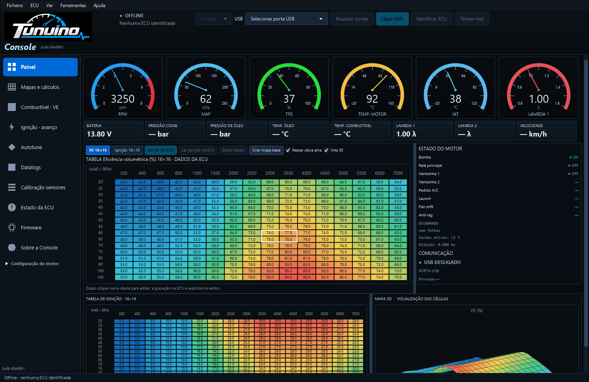
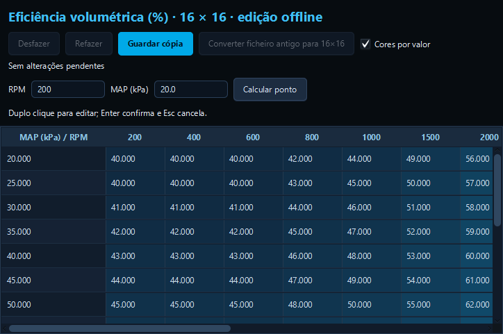

# Tabelas estáveis, redimensionamento e logótipo

O desenho das tabelas usava o tamanho do contentor, mas também participava no cálculo do tamanho preferido desse contentor. Essa dependência fazia a área pedir um novo tamanho quando era redesenhada. Os desenhos VE, ignição e 3D passam a seguir apenas o espaço atribuído, respeitando as bordas, sem alterar as medidas pedidas ao layout.

## Ajustar os painéis

Arrasta as barras entre a tabela VE e Estado do motor, entre ignição e vista 3D, ou entre as duas zonas de tabelas. A monitorização e a releitura de mapas não repõem as divisões iniciais. A coluna Registo continua removida. Estas posições ainda não são guardadas ao fechar a aplicação.

As janelas do editor têm redimensionamento e maximização nativos, dimensões iniciais ajustadas à área útil do ecrã e controlos que passam à linha quando a janela encolhe. As barras de deslocamento permitem chegar a todas as células em janelas pequenas. Redimensionar não altera valores, eixos nem envia comandos para a ECU.

## Logótipo

O cabeçalho usa o ficheiro PNG original Tunuino, também usado pela aplicação, preservando as suas proporções. Foi retirado o símbolo de chip redesenhado.

## Capturas Windows

Capturas da aplicação JavaFX empacotada, build d0e69b1, com dados sintéticos de teste e sem ligação física a uma ECU.

## Verificação

O teste do tamanho preferido falhou com o código anterior e passou após a correção. A interface real verifica redução da área de desenho, sessenta recálculos de layout sem crescimento, movimento dos separadores, janela compacta e redimensionamento do editor de 740×520 para 1240×780, preservando as dezasseis linhas e dezasseis colunas. Verifica também que o cabeçalho carrega o PNG original com proporções preservadas.

Os testes usam dados sintéticos, sem ECU física. Esta alteração aplica-se ao atualizar a Console; o pacote continua a incluir a [correção USB ao guardar na ECU](correcao-gravacao-usb.md), que exige o firmware correspondente.

[Teste Windows](https://github.com/Tunuino/Tunuino/actions/runs/40611732770) · [Desktop e simulador](https://github.com/Tunuino/Tunuino/actions/runs/40611732737) · [Testes do núcleo](https://github.com/Tunuino/Tunuino/actions/runs/40611732915).

O Bundle [40611857303](https://github.com/Tunuino/Tunuino/actions/runs/40611857303) aprovou instalação, atualização, runtime, atalhos, desinstalação e preservação dos ficheiros do utilizador do instalador 1.0.110.
