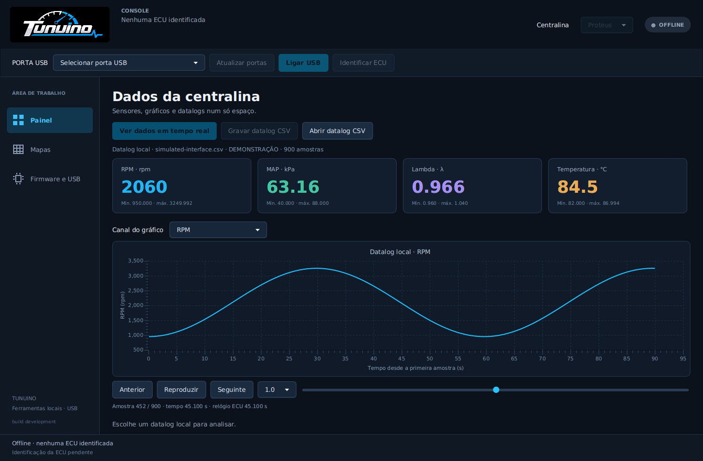
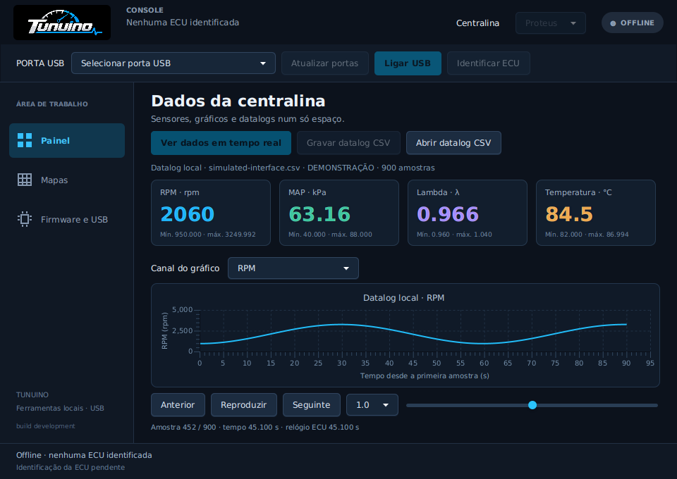
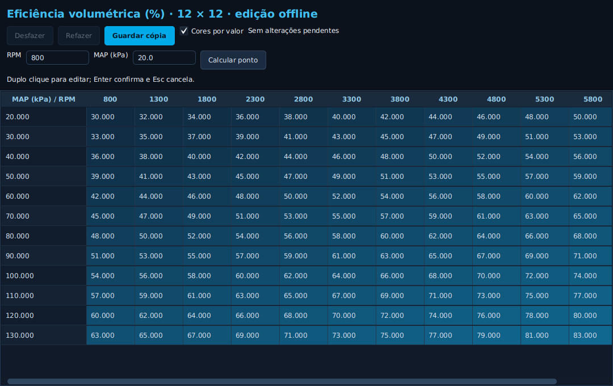
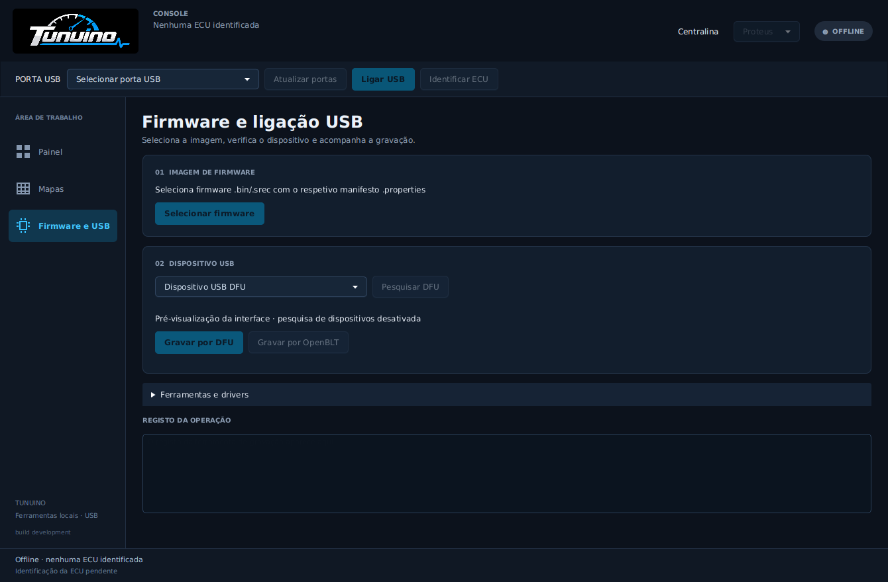

# Aspeto da Tunuino Console

Revisão de 25 de outubro de 2026. A interface foi integrada e passou nos testes desktop e no runtime Windows do pacote. As imagens desta página são capturas da aplicação JavaFX real com dados de demonstração, sem ligação a uma ECU. O [perfil 0.1.0](firmware-io-010.md) acrescenta entradas ADC, validade por sensor e gravação verificada de mapas; o respetivo ensaio físico continua pendente.

## Painel

Tema escuro com azul Tunuino, logótipo original e navegação lateral entre **Painel**, **Mapas** e **Firmware e USB**. A porta COM e os controlos de ligação ficam no cabeçalho; o estado USB, a identificação e os erros têm áreas próprias. A ligação passa a iniciar a identificação automaticamente.

Os quatro indicadores mostram RPM, MAP, lambda e temperatura. O gráfico permite escolher qualquer um destes canais. Num datalog local, o cursor, os botões Anterior/Seguinte e a reprodução com velocidade selecionável percorrem as amostras originais. O gráfico preserva extremos ao reduzir ficheiros extensos.

**Ver dados em tempo real** inicia a monitorização sem criar ficheiros. **Gravar datalog CSV** e **Parar gravação CSV** controlam o ficheiro enquanto a leitura continua. **Parar monitorização** termina o pedido em curso e fecha o CSV ativo. Estas funções só ficam disponíveis quando a identidade da ECU anuncia as capacidades necessárias. Dados indisponíveis apagam os valores atuais e deixam uma interrupção no gráfico.

## Janelas pequenas

O cabeçalho, a tipografia e os espaçamentos adaptam-se à altura disponível. Os quatro indicadores, a navegação do datalog e a barra de estado foram verificados em 1060 × 720 e 960 × 680. A disposição também se adapta a uma área útil de 640 píxeis de altura, contando com a moldura e a barra de título do Windows.

## Mapas

A área Mapas permite abrir um `.tnmap` local ou ler uma cópia da ECU quando o firmware suporta essa operação. O editor usa o mesmo tema, com cores relativas aos valores das células que podem ser desativadas em **Cores por valor**. Mantém edição decimal, desfazer/refazer, interpolação e gravação de uma nova cópia.

## Firmware e USB

Os controlos estão organizados em imagem de firmware, dispositivo USB e registo da operação. As ferramentas ST/OpenBLT e os drivers ficam num painel expansível. Os bloqueios de alvo, manifesto, integridade e verificação da gravação continuam ativos.

## Verificação

- Suite portátil C/Java aprovada, incluindo monitorização contra o simulador C real, início/fim de vários CSV, indisponibilidade/recuperação de sensores, recuo do relógio e preservação de ficheiros parciais.
- Aplicação JavaFX executada localmente: navegação entre áreas, tema e logótipo, seleção de canais, cursor, reprodução, ausência de dados, dimensões compactas e editor de mapas.
- A [execução 40184638618](https://github.com/Tunuino/Tunuino/actions/runs/40184638618) aprovou GCC, Clang, ARM, TunerStudio, desktop/JavaFX e Windows. O ensaio Windows executa a interface real com o Java do pacote distribuído, incluindo os controlos e o rodapé em janelas pequenas; guarda capturas como artefactos de CI.

As capturas desta página usaram o perfil USB anterior e dados de demonstração. Não demonstram medições numa ECU. Para o ensaio de entradas e sensores do novo firmware, usar o guia 0.1.0; a confirmação USB anterior não valida automaticamente essas funções.

[Código em revisão](https://github.com/Tunuino/Tunuino/pull/1) · [Gravação de firmware](console-firmware-usb.md) · [Estrutura e funções](estrutura-e-funcoes.md) · [Workflows](workflows.md).
