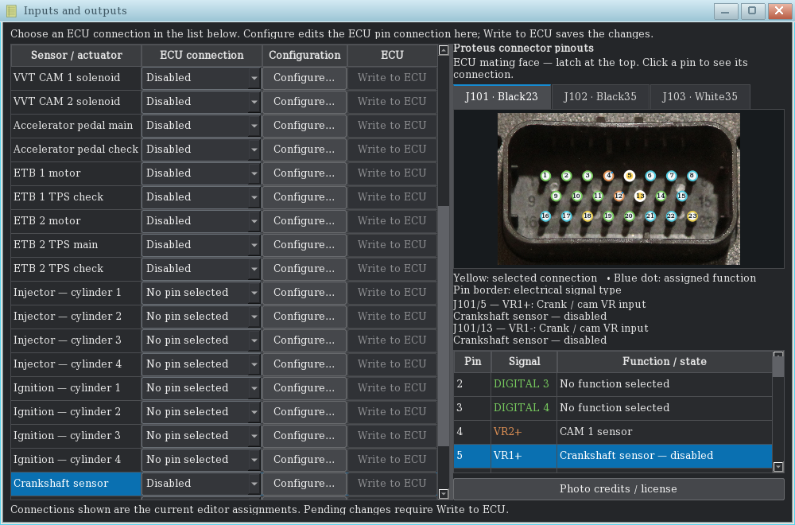
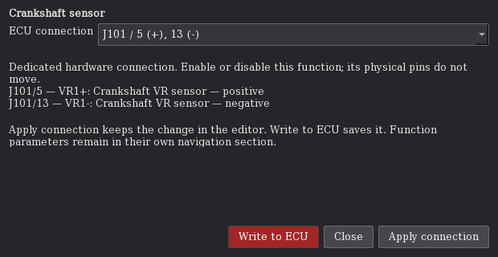

# Entradas, saídas e pinouts da Proteus

A configuração física fica num único local: **Inputs and outputs**, na navegação principal. Na coluna **ECU connection**, selecionar a ligação pretendida para o sensor ou atuador. **Configure...** abre a configuração da ligação física no próprio painel de I/O; **Write to ECU** grava através da transação existente.

## Conectores com fotografias

O painel inclui as fotografias dos três conectores, com numeração sobreposta:

| Separador | Conector da placa | Contactos |
| --- | --- | --- |
| Black23 | J101 | 23 |
| Black35 | J102 | 35 |
| White35 | J103 | 35 |

A vista é a **face de encaixe da ECU, com o fecho em cima**, conforme as fotografias. Não é a vista traseira dos fios da ficha. A imagem mantém a proporção ao redimensionar; o divisor permite ajustar a área da lista e a do pinout.

- Selecionar uma função destaca os seus contactos e abre o conector correspondente. Motores ETB e sensores VR destacam os dois contactos.
- Clicar num pino mostra o seu sinal e a função atribuída. Quando existe atribuição, seleciona a respetiva linha na lista de funções.
- A tabela por baixo da fotografia lista todos os contactos do conector, o sinal elétrico e as funções atribuídas nos editores.
- O amarelo assinala a ligação selecionada; um ponto azul identifica contactos com função atribuída. A cor do contorno distingue o tipo elétrico.
- As alterações locais pendentes são identificadas como **pending**; a fotografia não é uma medição da cablagem instalada.
- As fotografias e o mapa de contactos estão incluídos no executável: não exigem navegador ou ligação à Internet. Os créditos e a licença das fotografias podem ser consultados no próprio painel.

O mapa foi confrontado com os **93 contactos do esquema e do PCB Proteus v0.7**, revisão `383558bf7ca1c53ad8bbd8fdc9dd3a4187013c46`. Inclui AV, AT, entradas digitais/VR, pontes H, LS, ignição, HS, CAN, knock, massas e alimentações. Mostrar uma ligação física não acrescenta um controlador de firmware para esse sinal.

## Configure e estado dos pinos

**Configure...** abre a janela **ECU pin** da função selecionada, com a ligação escolhida, os contactos e os seus sinais elétricos. Não abre Triggers nem os parâmetros de funcionamento da função.

- **Apply connection** aplica apenas a ligação no editor local.
- **Write to ECU** usa a gravação existente da função, com validação e releitura.
- **Close** sem aplicar descarta a seleção preparada nessa janela. Uma ligação já aplicada permanece no editor até ser gravada ou descartada pelos mecanismos existentes.

A seleção é a mesma da coluna ECU connection: não existe uma segunda configuração de cablagem nos parâmetros da função. Os tipos elétricos apresentados são informação do hardware; não foram acrescentados seletores fictícios de Hall/VR, pull-up ou limiares que o firmware não controla.

| Texto apresentado | Significado |
| --- | --- |
| No pin selected | A função ainda não tem uma ligação de ECU selecionada. |
| No function selected | O contacto configurável não tem uma função de software atribuída. Não indica se há um fio fisicamente ligado. |
| Crankshaft sensor — disabled | J101/5 (+) e J101/13 (−) continuam a ser a entrada dedicada de cambota; a captura está desativada no editor. |
| Função — disabled | Entrada digital dedicada de VSS ou CAM 2, com a função desativada. |
| Fixed hardware connection | Alimentação, massa ou outra ligação física fixa apresentada como informação do conector. |
| pending | Existe uma alteração local pendente de gravação. |

Os contactos dedicados continuam identificados, selecionáveis e destacados com a função desativada. Não são transformados em contactos livres nem ativados automaticamente para preencher o pinout.

## Editar e gravar

As listas de ligações podem ser usadas **offline** para preparar o projeto. A disponibilidade de gravação na ECU não desativa a edição local. Ligações fixas são apresentadas sem uma escolha fictícia de terminal.

A gravação mantém as validações de compatibilidade e conflitos, a cópia anterior e a releitura. Não é feita qualquer gravação por selecionar um pino ou abrir uma fotografia. **Write to ECU** permanece dependente da disponibilidade e estado da ECU. O vermelho indica alterações locais pendentes.

As atribuições não se repetem nos parâmetros de Fueling, Ignition, VVT ou ETB. O TPS principal continua a ser a entrada única **TPS / ETB 1 main**. O pedal apresenta entradas principal e de verificação; cada motor ETB usa a ponte H escolhida no painel central. A nomenclatura dos sinais de verificação das borboletas identifica explicitamente **TPS**.

## Referências e verificação

Consultado o **EMU_PRO_Software_Guide.pdf**, páginas **10–11** (entradas/saídas atribuídas) e **19–20** (recursos por função), além das três fotografias fornecidas pelo utilizador. O PDF descreve organização e recursos; não contém o pinout Proteus. O pinout elétrico é fundamentado no KiCad/PCB da revisão indicada, e a posição dos números corresponde às fotografias originais dos conectores.

Verificação automatizada com a janela real da Console: carregamento das três fotografias incluídas, tabelas de 23/35/35 contactos, seleção por clique, destaque do injetor no contacto correto, edição offline com escrita indisponível e preservação do projeto ao consultar fotografias. A verificação dos 93 contactos compara as redes do esquema com as do PCB; as redes sem nome dos dois fusíveis são comparadas pela conectividade física.

Estes resultados são execução da interface em computador e inspeção dos ficheiros de hardware. Não constituem ensaio elétrico de uma cablagem física.

[Código da Console](https://github.com/Tunuino/Tunuino/commit/3310233196c776a7f92877443c40e00e8b2b75df).

Validação local: 17/17 testes aprovados e verificação visual dos três conectores com o tema da aplicação. A compilação e os testes Windows são executados pelo workflow automático da Console.

Testes adicionais da correção: Configure da cambota abre ECU pin mantendo a mesma janela MDI; os dois contactos dedicados continuam identificados com captura desativada; escolher sem aplicar e fechar preserva o projeto; Apply altera a ligação no editor sem gravação automática; restauração preserva os restantes campos. Verificação visual da janela com o tema da aplicação.

[Compilação e testes Windows desta correção](https://github.com/Tunuino/Tunuino/actions/runs/44379756152).

## Configuração do pino na interface

Capturas locais de teste, sem ECU ligada. A primeira mostra a função dedicada desativada; a segunda mostra a escolha preparada antes de aplicar. Créditos e termos das fotografias integradas: [PHOTO-LICENSE.txt](https://github.com/Tunuino/Tunuino/blob/3310233196c776a7f92877443c40e00e8b2b75df/qt_console/assets/proteus/PHOTO-LICENSE.txt).
