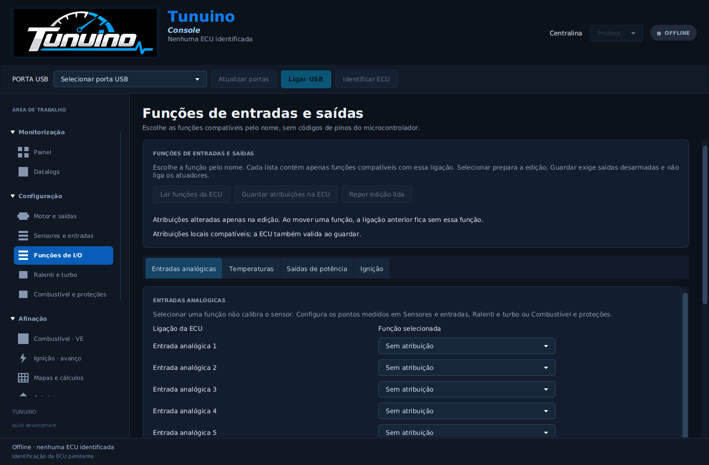
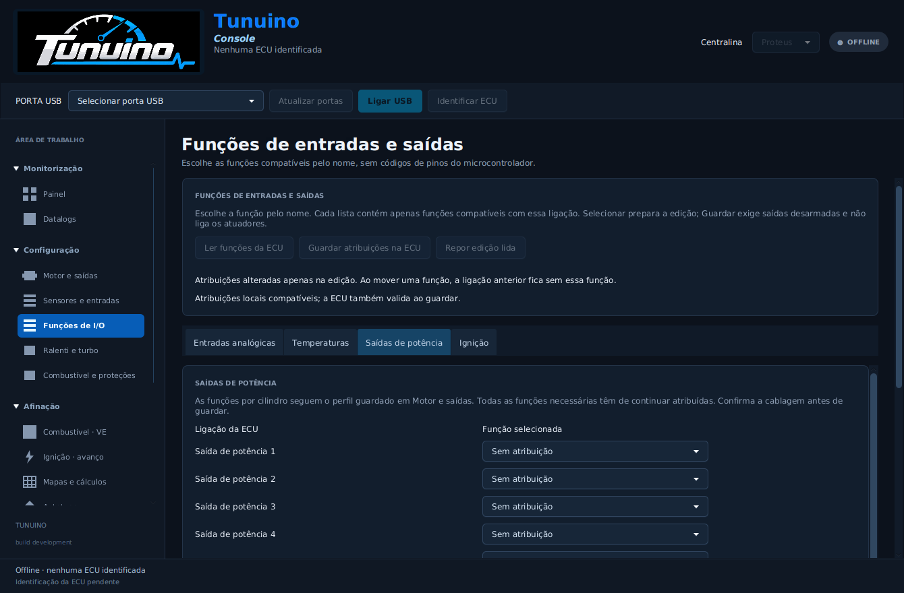
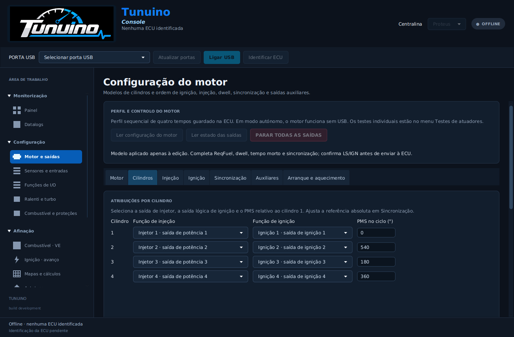

# Escolher entradas e saídas pelo nome da função

A Console passa a ter **Configuração → Funções de I/O**. Em vez de escolher códigos de pinos do microcontrolador, escolhe a função pelo nome. Cada ligação da ECU apresenta apenas as funções compatíveis com o seu tipo.

| Ligação | Funções disponíveis |
|---|---|
| Entrada analógica | MAP — pressão do coletor; lambda; TPS — posição da borboleta; tensão da bateria; etanol analógico; comando de launch |
| Entrada de temperatura | CLT — temperatura do motor; IAT — temperatura do ar |
| Saída de potência | Injetor de cada cilindro; bomba de combustível; ventoinha; relé principal; válvula de ralenti; válvula de controlo do turbo |
| Saída de ignição | Ignição de cada cilindro |

As entradas dedicadas de cambota e cames mantêm as suas funções fixas. As saídas de ignição são sinais lógicos para etapas externas; não são saídas de potência para injetores ou relés. A lista respeita essas diferenças.

O quadro identifica **Entrada analógica 1**, **Saída de potência 1**, etc. Se precisares de localizar a ligação no conector, passa o rato sobre esse nome para consultar o terminal AV/AT/LS/IGN correspondente. Os códigos PA/PB/PC do MCU não são opções de configuração.

## Configurar e guardar

1. Configura e guarda o perfil de cilindros em **Motor e saídas**. Sem perfil, a edição offline mostra o catálogo de funções até 12 cilindros; guardar funções de atuadores exige um perfil válido.
2. Prepara as calibrações reais dos sensores em **Sensores e entradas**, **Ralenti e turbo** e **Combustível e proteções**, conforme a função. Atribuir uma função não inventa a curva de um sensor nem ativa um modo de controlo.
3. Abre **Funções de I/O** e escolhe **Ler funções da ECU**.
4. Em cada ligação, seleciona **Sem atribuição** ou a função pretendida. Se moveres uma função, a atribuição anterior é retirada. Se ocupares uma ligação que tinha outra função, essa outra função fica por atribuir; a validação impede guardar se faltar um injetor ou uma saída de ignição necessária.
5. Revê a lista de alterações e escolhe **Guardar atribuições na ECU**, com as saídas desarmadas. A Console valida, guarda as páginas de sensores/motor e auxiliares numa única operação e confirma ambas por nova leitura. Guardar não arma as saídas.

Referências de calibração sobrepostas que fossem permitidas com controlos desligados são assinaladas no quadro. Escolhe explicitamente a função a manter nessa ligação; não são silenciosamente transformadas noutra atribuição.

As calibrações, PMS, tempos, modos e mapas mantêm os valores anteriores. Selecionar uma função numa lista altera apenas a edição. As funções de ralenti/turbo continuam a exigir que escolhas o modo apropriado na respetiva página.

## Outras janelas

Os seletores de sensores, cilindros, bomba, ventoinha, relé, TPS, ralenti, turbo, IAT, tensão, etanol, launch e testes também passam a mostrar nomes de funções. Os valores numéricos usados no protocolo permanecem internos. O INI TunerStudio revisão 10 apresenta nomes funcionais nas suas listas.

Depois de uma alteração de atribuições, a Console invalida a cópia anterior das saídas usada para testes. Lê novamente o perfil em **Motor e saídas** antes de testar relés, para que «bomba» e «ventoinha» correspondam às ligações agora guardadas.

## Verificação

Os testes C/Java percorrem a alteração de MAP, injetor e IAT através do adaptador de firmware real, com hardware simulado. Verificam compatibilidade, retirada da atribuição anterior, uma única gravação/geração, preservação de calibrações, não armação, recusa de snapshots antigos e recusa de escritas com saídas armadas. A interface JavaFX verifica as listas funcionais e a manutenção dos valores enviados à ECU.

Não foi realizado aqui ensaio elétrico das novas atribuições na ECU. Confirmar sempre que a função selecionada corresponde ao componente fisicamente ligado.

## Imagens da interface

Capturas do teste automático da Console, sem ECU ligada. O quadro começa sem atribuições até ler a configuração; o exemplo de cilindros usa um modelo local de quatro cilindros.

## Publicação verificada — Console 1.0.101

Código na `master`: [57b2ae5](https://github.com/Tunuino/Tunuino/commit/57b2ae571a1cd762f72854efde89005a04ddf81a); implementação principal: [71dda9a](https://github.com/Tunuino/Tunuino/commit/71dda9af6f6b931c85aae63dcffd3e173b9613a0). Passaram núcleo C/Java, INI, interface desktop, Console Windows e firmware. O [Bundle 40551648797](https://github.com/Tunuino/Tunuino/actions/runs/40551648797) confirmou instalação, atualização, atalhos, runtime instalado, desinstalação e preservação dos ficheiros do utilizador. O instalador é **1.0.101**.

- [Instalador Windows x64](https://github.com/Tunuino/Tunuino/releases/download/nightly-2026-10-27-40551966727/tunuino_setup_windows_x64.msi)
- [Bundle portátil ZIP](https://github.com/Tunuino/Tunuino/releases/download/nightly-2026-10-27-40551966727/tunuino_bundle_proteus_v07_f427_usb_bench.zip)
- [Release com componentes do mesmo commit](https://github.com/Tunuino/Tunuino/releases/tag/nightly-2026-10-27-40551966727)

Esta publicação altera a apresentação e a atribuição de funções; não acrescenta controlo VVT, detonação, borboleta eletrónica nem Autotune. O estado dessas funções continua documentado em [Combustível e proteções](combustivel-protecoes.md).
