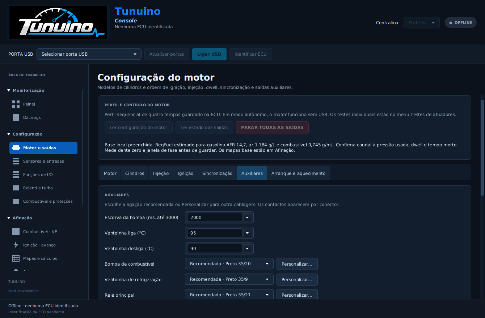
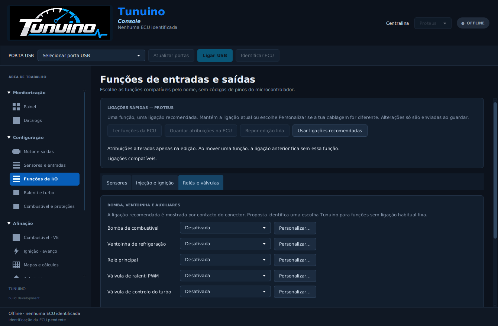

# Ligações rápidas da Proteus

Disponível na **Console 1.0.102**, publicada em 27 de outubro de 2026. [Instalador Windows](https://github.com/Tunuino/Tunuino/releases/download/nightly-2026-10-27-40568652689/tunuino_setup_windows_x64.msi) · [Pacote e notas da versão](https://github.com/Tunuino/Tunuino/releases/tag/nightly-2026-10-27-40568652689).

A configuração passa a apresentar uma linha por função e uma escolha curta. A lista normal contém apenas:

- **Desativada**.
- **Recomendada**, identificada pelo conector e contacto.
- **Atual**, quando a configuração lida utiliza outra ligação.

**Personalizar…** abre os restantes contactos compatíveis. A matriz completa de terminais fica em **Avançado**, fechada por predefinição. Não é necessário percorrer 16 opções com o mesmo nome para escolher a ligação habitual de uma bomba.

## Aspeto da Console

Escolhas rápidas de bomba, ventoinha e relé, com a ligação recomendada visível:

Atribuição por função, separada em Sensores, Injeção e ignição, Relés e válvulas:

As imagens são de testes automáticos da interface, sem ECU ligada. Uma função desativada mantém esse estado até ser escolhida e guardada uma ligação.

## Ligações habituais

| Função | Conector | Contacto |
|---|---|---|
| MAP — pressão do coletor | Branco 35 | 13 |
| TPS — posição da borboleta | Branco 35 | 24 |
| CLT — temperatura do motor | Branco 35 | 20 |
| IAT — temperatura do ar | Branco 35 | 30 |
| Lambda analógica de controlador wideband | Branco 35 | 28 |
| Relé da bomba de combustível | Preto 35 | 20 |
| Relé da ventoinha | Preto 35 | 9 |
| Relé principal | Preto 35 | 21 |

Os injetores e saídas de ignição seguem a numeração dos cilindros no pinout. A ordem de ignição e os ângulos mantêm-se no perfil do motor. As ligações acima são apresentadas diretamente como, por exemplo, **Recomendada · Preto 35/20**. Não são códigos de GPIO do microcontrolador.

As recomendações de conector foram conferidas com os contactos J102/J103 do PCB Proteus fixado no projeto. Essa conferência de fonte não constitui ensaio de continuidade ou validação elétrica da tua ECU.

## Usar sem alterar configurações anteriores

Ler a ECU ou atualizar a Console mantém as ligações guardadas. Uma ligação personalizada aparece como **Atual**, mesmo que não seja a habitual. O seletor nunca a troca automaticamente.

Em **Funções de I/O**, o botão **Usar ligações recomendadas** prepara uma alteração para as funções já atribuídas. Não ativa sensores novos nem muda modos de ralenti/turbo. É necessário rever e guardar para enviar à ECU, com as saídas desarmadas.

Se o contacto recomendado estiver ocupado por outra função, a escolha rápida mantém a configuração anterior e identifica o conflito. Em motores com muitos cilindros, injetores e relés podem disputar os contactos habituais: usar uma ligação personalizada compatível nesse caso. Não há redistribuição automática de funções alheias.

Os novos modelos locais de motor de 1 a 8 cilindros propõem agora bomba, ventoinha e relé principal nos contactos habituais acima. As calibrações de combustível, sensores, PMS e componentes continuam a exigir os valores reais do motor.

## Propostas e funções sem contacto fixo

A identificação **Proposta** distingue uma escolha da aplicação de uma ligação habitual dedicada. São propostas iniciais: ralenti PWM em Preto35/10, turbo em Preto35/11, etanol analógico em Branco35/25 e launch condicionado em Branco35/26. Usar apenas quando correspondem à instalação e ao componente configurado.

A compensação por tensão permanece associada à calibração analógica externa suportada pelo firmware; não é anunciada uma ligação habitual para essa função. O canal dedicado de alimentação não passa a ser realimentação desse controlo por uma simples mudança de interface.

## Testes de atuadores

Os testes passam a listar os injetores e saídas de ignição realmente atribuídos aos cilindros no perfil lido. O nome identifica o cilindro e o contacto. Antes de testar, lê o perfil de motor guardado. Não aparecem 16 variantes indistintas de «bomba» ou «injetor» como seleção normal.

## Verificação

Os testes verificam os contactos recomendados, listas normais de duas ou três escolhas, preservação de uma ligação personalizada, rejeição de contactos ocupados, matriz avançada fechada e codificação numérica exata dos perfis. A lógica de firmware e o protocolo de atribuição não foram alterados. Estes são testes de software e modelos de hardware no computador; não substituem ensaio elétrico.

Código: [9ebfdcb](https://github.com/Tunuino/Tunuino/commit/9ebfdcb506c1b2ddab95b3f4024b18028a994011). Passaram os testes do núcleo, interface JavaFX, simulador, compilação de firmware, INI, Console Windows e [Bundle 40568370235](https://github.com/Tunuino/Tunuino/actions/runs/40568370235). O Bundle verificou o instalador MSI 1.0.102, instalação, atualização e preservação de dados. Validação física desta alteração pendente.
