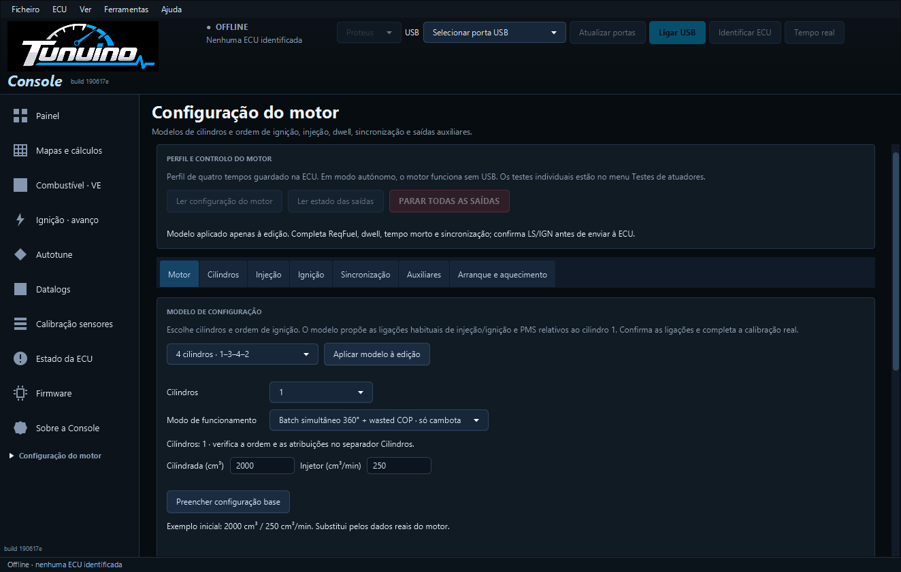
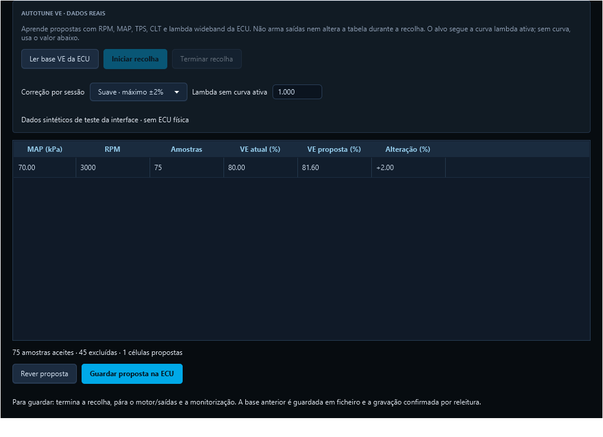

# Modos 360° e Autotune VE com dados reais

**Console 1.0.112 · build 190617e.**

[Instalador Windows](https://github.com/Tunuino/Tunuino/releases/download/nightly-2026-10-28-40668465000/tunuino_setup_windows_x64.msi) · [Bundle e notas da versão](https://github.com/Tunuino/Tunuino/releases/tag/nightly-2026-10-28-40668465000).

**Para usar os modos 360°, instala a Console e grava o firmware incluído na Proteus por DFU.** Instalar apenas a Console não acrescenta os modos ao firmware antigo.

Esta atualização acrescenta modos de atuação ao firmware Proteus v0.7 STM32F427 e substitui o menu Autotune indisponível por recolha USB e propostas VE. O fluxo normal da Console usa a ECU real. O simulador permanece separado nas ferramentas de desenvolvimento e nos testes; removê-lo não acrescentaria aquisição nem controlo físico.

## Modos de funcionamento

Em Configuração do motor → Motor e saídas → Motor, a lista Modo de funcionamento passa a ter três escolhas:

| Modo | Injeção | Ignição | Referência necessária |
|---|---|---|---|
| Sequencial 720° | Um evento por cilindro e ciclo | Uma ignição por ciclo | Cambota e fase de cames |
| Semi-sequencial 360° + wasted COP | Dois eventos por ciclo, relativos ao PMS de cada cilindro módulo 360° | Uma ignição por volta | Cambota |
| Batch simultâneo 360° + wasted COP | Todos os injetores terminam no mesmo ângulo, duas vezes por ciclo | Uma ignição por volta, no ângulo de cada cilindro | Cambota |

Wasted COP conserva uma saída independente por bobina/cilindro. Não atribuir a mesma saída a dois cilindros. Bobinas duplas com saída partilhada por pares ainda não estão implementadas. As doze saídas de ignição são sinais lógicos para etapas externas.

O combustível efetivo por ciclo é repartido pelos dois eventos nos modos 360°; o tempo morto é somado em cada pulso. Mantêm-se os limites de dwell, pulso, ocupação de 80% do período real, falhas de aquisição e corte retido. Perda de cambota pára as saídas. No sequencial, perder a fase continua a causar corte; não há mudança automática para outro modo.

Os novos modos usam o perfil formato 2 no mesmo espaço de configuração e no mesmo registo flash. O formato 1 anterior continua válido e sequencial. Atualizar firmware, Console e INI em conjunto antes de selecionar um modo novo. O INI revisão 11 apresenta formato e modo; formato 1 exige modo 0, formato 2 exige modo 1 ou 2. Guardar nunca arma saídas. A política de funcionamento autónomo mantém-se.

## Autotune VE assistido

1. Calibra TPS, lambda wideband, MAP e CLT; guarda o perfil, as tabelas e as restantes funções.
2. Em Autotune, usa Ler base VE da ECU, com a monitorização parada.
3. Escolhe limite por sessão Suave ±2% ou Normal ±5%. Se a curva de alvo lambda estiver ativa na ECU, ela é usada; sem curva ativa, vale o alvo local introduzido.
4. Inicia Tempo real no cabeçalho e depois Iniciar recolha. A aprendizagem exige motor ativo, quente, carga estável e sensores válidos.
5. Termina a recolha e usa Rever proposta. Só aparecem células com amostras suficientes e correção consistente.
6. Pára o motor/saídas e a monitorização. Guardar proposta na ECU confirma que a base/geração não mudou, guarda uma cópia anterior e verifica a gravação por releitura.

Não há escrita automática durante o funcionamento. A correção PI de lambda é considerada para não esconder o erro de VE quando a malha fechada já aproxima a mistura do alvo. Células não visitadas e os eixos ficam intactos. Cada nova sessão parte de uma leitura da ECU, evitando acumular propostas sobre uma base antiga.

A recolha exclui arranque, afterstart, aquecimento ainda diferente de 100%, cortes, enriquecimento transitório, proteções e sensores inválidos. Exige CLT >=70°C, 1200–6000 rpm, TPS 5–80%, estabilidade durante 1500 ms, pelo menos doze amostras por célula e resposta USB recente. Flex fuel e ajustes individuais de cilindro têm de estar desligados para aprender VE. Só aprende próximo dos nós da tabela; não procura preencher toda a tabela a partir de uma única zona.

## Capturas Windows

Capturas dos testes da aplicação JavaFX empacotada para Windows, build 190617e. O exemplo de recolha usa dados sintéticos identificados como tal e não representa ensaio na ECU do utilizador.

## Testes e limites

O núcleo C/Java passou, incluindo os novos modos nos 12 cilindros entre 400 e 12 000 rpm, passagem do contador pelo limite e ausência de fase de cames. O teste do adaptador F427 usa os GPIO, GPT e comandos reais com registos de hardware de teste, incluindo arranque autónomo com perfil 360° persistente e corte por perda de cambota.

Os testes do Autotune verificam filtros, alvo/PI, limites, precisão, preservação de células não visitadas, invalidação por geração, observações no mesmo trabalhador série e base/backup/gravação/releitura pelo dispatcher C. Os testes de interface usam dados sintéticos identificados como tal. Não foram realizados aqui ensaios elétricos na Proteus nem num motor.

## Funções ainda pendentes

VVT, aquisição de detonação, borboleta eletrónica com supervisão redundante, ralenti stepper, flex fuel por frequência, rodas OEM adicionais, bobinas partilhadas por pares, mapa lambda 16×16, compensação barométrica, controlo por CAN, Lua e estratégias de transmissão/tração não ficam concluídos nesta atualização. Não são apresentados como funções operacionais nem substituídos por leituras fictícias.

Código: [190617e](https://github.com/Tunuino/Tunuino/commit/190617e0efcb22ee60dcd30eb3222709d9c432a6).

[Teste Windows](https://github.com/Tunuino/Tunuino/actions/runs/40668054494) · [Firmware](https://github.com/Tunuino/Tunuino/actions/runs/40668054476) · [Núcleo C/Java](https://github.com/Tunuino/Tunuino/actions/runs/40668054404) · [Desktop](https://github.com/Tunuino/Tunuino/actions/runs/40668054506) · [INI](https://github.com/Tunuino/Tunuino/actions/runs/40668054560).

O arredondamento para 0,01% VE mantém o limite escolhido mesmo em células muito pequenas; quando não existe uma alteração representável dentro desse limite, a célula fica inalterada.

O Bundle [40668215741](https://github.com/Tunuino/Tunuino/actions/runs/40668215741) aprovou instalação, atualização, runtime, atalhos, desinstalação e preservação dos ficheiros do utilizador do instalador 1.0.112.
