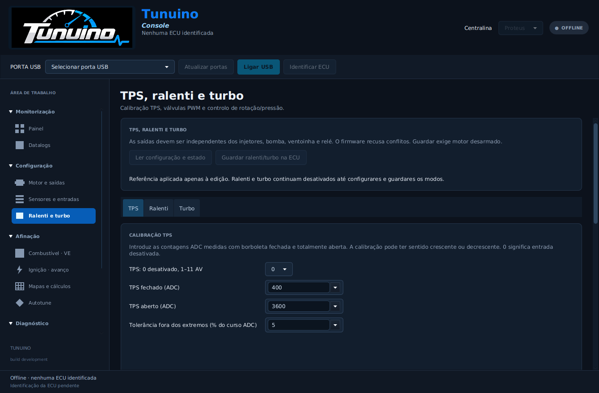
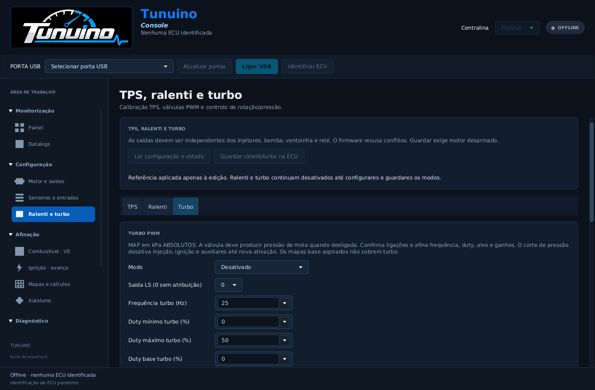

> Atualização: [painel, calibrações centralizadas e estabilidade de Firmware/USB](console-calibracoes-estabilidade.md).

# TPS, ralenti PWM e controlo de turbo

A Console e o TunerStudio passam a configurar TPS, ralenti e turbo. O firmware executa o PWM nas saídas LS atribuídas e controla a rotação/pressão nos modos PI. Os dois controlos começam desativados. Não foi realizado aqui ensaio elétrico nem ensaio com motor/válvulas reais.

## Onde configurar

Na Console: **Configuração → Ralenti e turbo**, com separadores **TPS**, **Ralenti** e **Turbo**. **Aplicar referência à edição** preenche valores iniciais locais e mantém os modos desligados. **Ler configuração e estado** recebe a página guardada, TPS e comandos de duty. **Guardar ralenti/turbo na ECU** exige saídas desarmadas, validação do firmware e confirmação por nova leitura. Guardar não arma o motor.

No TunerStudio: menus **TPS and idle PWM** e **Boost PWM and overpressure cut**. Atualizar firmware, Console e INI em conjunto. O TPS calibrado pode ser visto no indicador; o estado detalhado dos comandos PWM está na Console. Os valores de duty são comandos calculados, não medições de corrente nem realimentação elétrica da válvula.

## TPS

Selecionar uma entrada AV1–AV11 e introduzir contagens ADC medidas com a borboleta fechada e totalmente aberta. A curva aceita ambos os sentidos. A referência local propõe 400/3600 ADC e tolerância de 5% do curso, que devem ser substituídos pelos valores reais. A tolerância evita que ruído pequeno junto dos extremos provoque desligamentos; os valores nessa margem ficam limitados a 0/100%. Fora da margem ou sem ADC válido, o TPS fica indisponível e ambos os comandos PWM passam a zero.

TPS não pode partilhar a entrada selecionada para MAP ou lambda. Selecionar um canal não calibra automaticamente o sensor. A borboleta eletrónica não é comandada por esta função.

## Ralenti

| Modo | Comportamento |
|---|---|
| Desativado | Sem PWM de ralenti |
| PWM por temperatura | Duty interpolado numa curva de três temperaturas |
| PWM com controlo PI de RPM | Duty base da curva, corrigido pelo erro para o alvo RPM |

A curva contém temperatura, RPM alvo e duty base. A referência propõe −20/20/80 °C, alvos 1200/1000/850 rpm e duty 35/25/18%. São exemplos editáveis, não calibrações de válvulas específicas. A frequência de referência é 100 Hz; o intervalo aceite pelo firmware é 10–300 Hz.

Antes do sincronismo de funcionamento e abaixo do limiar de arranque utiliza o duty de arranque, respeitando os limites de duty. Para corrigir o ralenti, o TPS deve estar abaixo do máximo configurado, a temperatura deve ser válida e a rotação deve estar abaixo do limite de ativação. Fora destas condições, o comando é zero e o integrador é reiniciado.

P usa percentagem de duty por 100 rpm de erro; I acrescenta essa correção por segundo. O cálculo tem intervalo de 20 ms, limites e proteção contra acumulação do integrador quando a saída está saturada. Esta revisão suporta válvulas PWM de dois fios; não suporta motores de passo nem borboleta eletrónica.

## Turbo

| Modo | Comportamento |
|---|---|
| Desativado | Sem PWM de turbo |
| Duty fixo | Duty base configurado, quando RPM/TPS autorizam |
| Controlo PI de pressão MAP | Ajusta duty para o alvo de MAP absoluto |

**As pressões são absolutas em kPa.** 150 kPa não significa 1,5 bar de pressão relativa. A referência propõe 25 Hz, duty base zero, máximo 50%, alvo 150 kPa absolutos, corte 200 kPa absolutos, ativação acima de 2500 rpm e TPS 50%. O firmware aceita 10–100 Hz; escolher frequência, duty e ganhos adequados à válvula e instalação reais.

A válvula desligada deve produzir a pressão mecânica da mola da wastegate. A ligação com comportamento de falha invertido não é suportada. O controlo exige sincronismo de funcionamento, MAP/TPS válidos e os limites mínimos de RPM/TPS. Quando não autorizado, comanda duty zero e reinicia o integrador.

P usa percentagem por 10 kPa de erro, I por segundo. O limite de pressão deve ser superior ao alvo e caber na calibração MAP. Ao atingir esse limite enquanto o motor está armado, o firmware corta injeção, ignição e auxiliares e mantém a falha até ativação explícita ou reinício. A Console identifica a falha de pressão de turbo.

**Os mapas base aspirados 20–105 kPa não constituem mapas para turbo.** Preparar os eixos e a afinação real de combustível/ignição antes de utilizar sobrealimentação. Não há nesta revisão alvos de turbo por mudança, tabela de duty por RPM, VVT ou controlo de detonação.

## Saídas e temporização

Cada controlo exige uma LS exclusiva. O firmware recusa saídas ocupadas por injetores, bomba, ventoinha, relé principal ou pela outra válvula. As IGN não são opções para estas válvulas.

O PWM utiliza o mesmo temporizador de flancos e supervisão das saídas, preservando o contador de referência do motor. Duty zero desliga imediatamente; outras alterações entram no período seguinte. O agendador impõe separação mínima de 0,010 ms entre flancos PWM. STOP, prazo de supervisão expirado ou atraso de temporização desativam todos os canais. Frequência e duty reais sob carga ainda exigem medição elétrica.

## Gravação e cópias

Foi acrescentada uma página 4 de 256 bytes, mantendo os offsets dos sensores, motor e mapas anteriores. Os registos antigos são lidos com esta página desligada. A primeira gravação no formato novo é confirmada no outro banco de flash antes de se abandonar o registo antigo. O ensaio automático interrompe a gravação em cada palavra e confirma recuperação do registo válido.

Guardar três tipos de ficheiros para uma cópia completa: perfil/sensores `.tncfg`, mapas `.tnmap` e auxiliares `.tnaux`. O `.tnaux` tem CRC e validação; abrir uma cópia apenas preenche a edição. Gravações em ficheiros existentes são recusadas para preservar a cópia anterior.

Firmware antigo não consegue ler os registos novos e pode recuperar dados antigos de um banco legado ou iniciar sem configuração. Exportar as cópias antes de qualquer downgrade.

## Verificação

Os testes exercitam o cálculo PI, interpolação, tolerância e inversão de TPS, condições de autorização, saturação, sobrepressão, flancos PWM simultâneos com injeção, paragem, passagem dos contadores por zero, rejeição de conflitos, leitura/gravação C/Java, backups e migração com gravações interrompidas. Os testes de GPIO/flash usam modelos de registos e não substituem o ensaio físico na Proteus.

## Imagens e lançamento

Implementação: [1e2c6f7](https://github.com/Tunuino/Tunuino/commit/1e2c6f7800ff67bcb376e0725a33dff2b27e2907). Os cinco processos de componentes passaram: núcleo, TunerStudio, interface desktop, Console Windows e firmware F427. [Bundle/instalador 40506368712](https://github.com/Tunuino/Tunuino/actions/runs/40506368712) passou nos ensaios de instalação, atualização e desinstalação. O [Release foi publicado](https://github.com/Tunuino/Tunuino/releases/tag/nightly-2026-10-27-40506620057), com componentes do mesmo commit.

[Instalador Windows](https://github.com/Tunuino/Tunuino/releases/download/nightly-2026-10-27-40506620057/tunuino_setup_windows_x64.msi) · [Bundle ZIP](https://github.com/Tunuino/Tunuino/releases/download/nightly-2026-10-27-40506620057/tunuino_bundle_proteus_v07_f427_usb_bench.zip).

Atualização seguinte: [combustível e proteções](combustivel-protecoes.md) acrescenta flex fuel analógico, launch, IAT/tensão, lambda e outras estratégias. VVT, detonação e borboleta eletrónica continuam pendentes, com dependências detalhadas nessa página.
