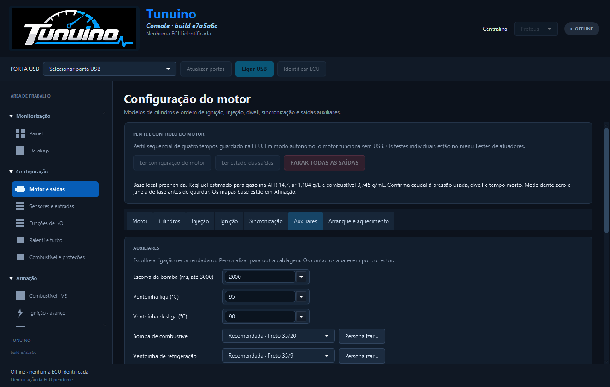
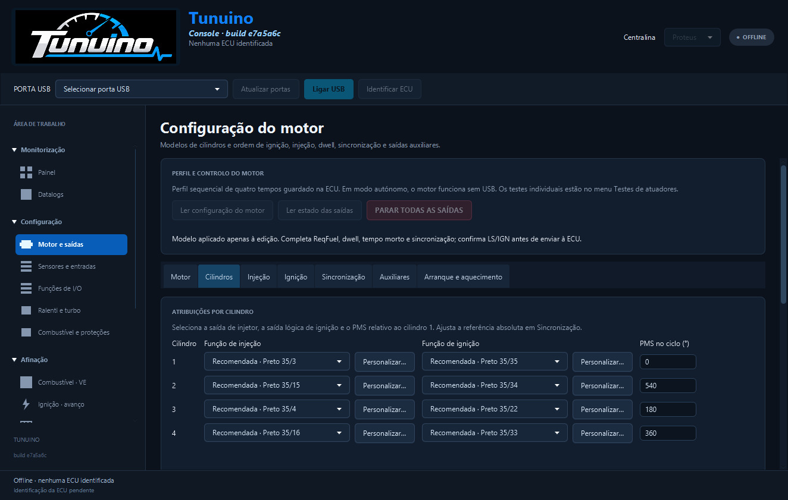
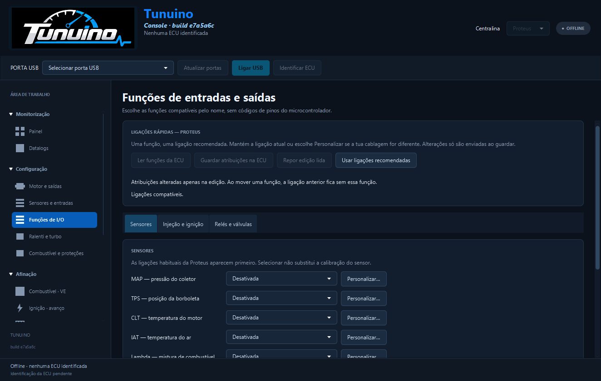

# Revisão completa das seleções de entradas e saídas

**Console 1.0.103 · build e7a5a6c**. [Instalador Windows](https://github.com/Tunuino/Tunuino/releases/download/nightly-2026-10-27-40577389724/tunuino_setup_windows_x64.msi) · [Pacote e notas](https://github.com/Tunuino/Tunuino/releases/tag/nightly-2026-10-27-40577389724).

A revisão abrange todas as páginas de configuração da Console, incluindo separadores fechados. Não se limita à bomba ou à ventoinha.

| Área | Seletores de ligação verificados |
|---|---:|
| Sensores: MAP, lambda e temperatura do motor | 3 |
| Motor: 12 injetores, 12 ignições, bomba, ventoinha e relé | 27 |
| TPS, ralenti e turbo | 3 |
| IAT, tensão, launch e etanol analógico | 4 |
| Funções de I/O: sensores, relés e válvulas, sem perfil de cilindros carregado | 13 |
| **Total** | **50** |

Em todos os seletores normais de ligação, o teste verifica um máximo de três escolhas: Desativada, Recomendada/Proposta e Atual quando diferente. O contacto aparece pelo conector físico. A lista completa exige o botão separado Personalizar. As atribuições completas por terminal ficam em Avançado, fechado inicialmente.

As ligações personalizadas de sensores, dos 12 injetores, das 12 ignições e dos três relés são verificadas sem substituir silenciosamente o canal numérico guardado. A codificação do perfil mantém os canais originais e os tempos em milissegundos na interface.

A revisão inclui os três separadores de testes de atuadores. Com um perfil sintético de um cilindro, só aparecem esse injetor e essa ignição; os relés são escolhidos pelas três funções reais. Os botões continuam bloqueados sem ECU ligada. Os testes não enviam pulsos físicos.

## Identificar a aplicação aberta

O cabeçalho passa a mostrar **Console · build …** junto ao logótipo. Esse identificador pertence ao JAR realmente aberto, mesmo quando há uma cópia portátil antiga noutra pasta. O nome do ficheiro descarregado, por si só, não identifica o executável que está em execução.

Se aparecer uma lista longa como «Bomba de combustível · saída de potência 1, 2, 3…» ou «Ventoinha de refrigeração · saída de potência 1, 2, 3…», é o seletor anterior. As listas da versão revista mostram a recomendação e Personalizar.

Para atualizar: fecha todas as janelas da Console, executa o instalador desta publicação e abre TunuinoConsole pelo menu Iniciar. Para usar o ZIP portátil, extrai-o para uma pasta nova e abre o executável dessa pasta. Confirma o build no cabeçalho. Os ficheiros de mapas, configurações e registos continuam na pasta de dados do utilizador.

## Imagens da aplicação Windows verificada

O cabeçalho identifica **build e7a5a6c**. Estas capturas vêm do teste Windows com o runtime e JAR empacotados, usando dados sintéticos.

[Relatório dos 50 seletores e respetivas escolhas](relatorio-seletores-console.tsv).

## Evidência e limites

A auditoria percorre os controlos reais da aplicação, mesmo em separadores não selecionados, e grava cinco relatórios TSV nos artefactos da interface. Os relatórios registam o identificador de cada seletor e as escolhas apresentadas.

A execução é feita com dados sintéticos, sem ECU nem revisão elétrica. O teste Windows usa o runtime e o JAR da aplicação empacotada. Os testes do instalador verificam o conteúdo instalado e os atalhos, atualização, desinstalação e preservação de dados. Não confirmam qual cópia está aberta no computador do utilizador.

Código: [e7a5a6c](https://github.com/Tunuino/Tunuino/commit/e7a5a6c08c08b9d142c23cdc1dd6dcb879086445). Passaram a revisão completa da interface no [Windows](https://github.com/Tunuino/Tunuino/actions/runs/40576951792) e no [Linux](https://github.com/Tunuino/Tunuino/actions/runs/40576951796), assim como testes unitários, firmware e validação do INI.

O [Bundle 40577148949](https://github.com/Tunuino/Tunuino/actions/runs/40577148949) verificou o MSI **1.0.103**: instalação, conteúdo instalado/runtime, atalhos, atualização, desinstalação e preservação de ficheiros do utilizador.
